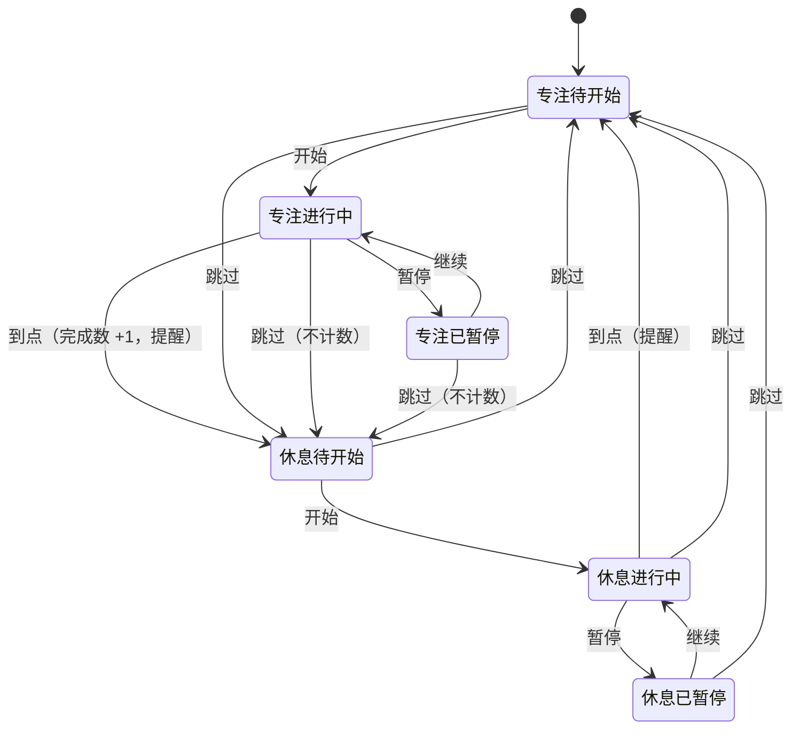

## Feature Spec：番茄钟网页

**版本**: v1.0
**状态**: 已确认
**关联 Feature**: pomodoro-timer
**来源**: `docs/PRD.md`；讨论原文 `docs/archive/raw/discussions/番茄钟/2026-10-23-番茄钟-需求讨论.md`（以其 §9.2 最终决策为准）

> 措辞：**SHALL / 必须** = 强制，违反即 bug；**SHOULD / 应该** = 推荐；**MAY / 可以** = 可选。

---

### 一、用户流程总览

**入口**: 用户在浏览器里打开番茄钟页面（本地文件或以后挂到 GitHub Pages 的网址），无需注册登录。
**出口**: 没有终点。用户把页面留在一个标签页里，一段专注、一段休息地循环；随时看页面或标签页标题就知道还剩多久、今天完成了几个。

```
打开页面 → 专注待开始(25:00) → 点「开始」→ 专注进行中 ──到点──→ 完成数 +1，提醒 → 休息待开始(05:00)
              ↑                   │  ↑                                                │
              │              「暂停」│  │「继续」                                          点「开始」
              │                   ↓  │                                                ↓
              │               专注已暂停                                            休息进行中
              │                                                                     │
              └──────────────────────────── 到点，提醒 ←─────────────────────────────┘

任何状态点「跳过」：直接切到另一阶段的「待开始」，不计数、不提醒
关掉 / 刷新 / 浏览器自动重载后再打开：按「保存与恢复」规则回到原来的状态（见 R5）
```

**流程说明**:
1. 打开页面：没有记录时显示「专注 25:00」和「开始」按钮，今天完成 0 个。
2. 点「开始」：倒计时开始；可以暂停、继续、跳过。
3. 专注到点：今天完成数加一，响一声提示音，标签页标题交替显示到点提示；页面切到「休息 05:00」，等用户点「开始」。
4. 休息到点：响一声提示音，标题交替提示；页面切回「专注 25:00」，等用户点「开始」。
5. 循环以上步骤。过了本机零点，今天完成数从零开始。

状态流转图（与讨论原文 §6 一致，补上「待开始也可跳过」）：



---

### 二、页面/系统结构（全局 → 组件）

#### 整体布局

单页，内容居中成一列，桌面和手机同一套结构，只随屏幕宽度缩放：

```
┌───────────────────────────────┐
│                               │
│            专注                │  ← 阶段标签（专注 / 休息）
│                               │
│           24:59               │  ← 剩余时间（页面上最大的元素）
│          已暂停                │  ← 状态说明（仅暂停或到点时出现）
│                               │
│      [  开始  ]   [ 跳过 ]      │  ← 主按钮 + 跳过按钮
│                               │
│        今天完成 3 个            │  ← 今日完成数
│                               │
│ 这个浏览器不能保存记录，刷新后…    │  ← 存储提示（仅存储不可用时出现）
└───────────────────────────────┘

浏览器标签页标题：「24:59 · 专注」（不在页面里，但是主要的信息出口）
```

#### 区块职责

| 区块 | 职责 | 包含组件 |
|------|------|---------|
| 计时区 | 告诉用户现在是哪一段、还剩多久、是否暂停或到点 | 阶段标签、剩余时间、状态说明 |
| 控制区 | 开始 / 暂停 / 继续 / 跳过 | 主按钮、跳过按钮 |
| 记录区 | 今天守住了几段专注；记录保存不了时说清楚 | 今日完成数、存储提示 |
| 页面外 | 页面不在眼前时也能提醒到人 | 标签页标题、提示音 |

#### 组件清单

**阶段标签**
- 职责: 显示当前阶段「专注」或「休息」。
- 交互: 无。
- 数据: 当前阶段。
- CSS 约束: 由 forge-design 在 DESIGN.md 定稿；本版只要求两个阶段在颜色或文字上能一眼区分。

**剩余时间**
- 职责: 以「分:秒」显示本段剩余时间（如 `24:59`，不足十分钟补零为 `09:05`）。
- 交互: 无。
- 数据: 进行中 = 结束时刻 − 当前时刻（向上取整到秒，不显示负数）；暂停 / 待开始 = 保存的剩余时长 / 本段完整时长。
- CSS 约束: 页面上字号最大的元素；数字等宽，走秒时不左右跳动（具体值由 DESIGN.md 定）。

**状态说明**
- 职责: 暂停时显示「已暂停」；到点后、用户还没操作时显示「专注结束」或「休息结束」。其余时候不显示、不占位跳动。
- 数据: 当前状态。

**主按钮**
- 职责: 一个按钮在「开始 / 暂停 / 继续」之间切换。
- 交互: 待开始 → 文案「开始」，点击后进入进行中；进行中 → 文案「暂停」，点击后暂停；已暂停 → 文案「继续」，点击后接着走。
- 数据: 当前状态。
- CSS 约束: 原生按钮，可用键盘操作；手机上足够大、好点（具体值由 DESIGN.md 定）。

**跳过按钮**
- 职责: 任何状态下直接切到另一阶段的「待开始」。
- 交互: 点击后立即切换，不弹确认框；跳过专注不计入完成数；不响铃、不触发标题交替。
- CSS 约束: 视觉上弱于主按钮。

**今日完成数**
- 职责: 显示「今天完成 N 个」，N 为本机日期当天走到点的专注段数量。0 个时照常显示「今天完成 0 个」。
- 数据: 本地保存的当天记录。

**存储提示**
- 职责: 浏览器不允许保存记录时，显示一行小字「这个浏览器不能保存记录，刷新后今天的完成数会清零」。能保存时不显示。
- 交互: 无，不可关闭（不弹窗、不遮挡计时区）。

**标签页标题**（页面外）
- 职责: 页面在后台时的主要信息出口，格式见 R4。

**提示音**（页面外）
- 职责: 到点时响一声短促、安静的提示音；不循环、不需要用户关闭。
- 数据: 无外部文件依赖要求（工程自行选择合成或内置音频）。

---

### 三、行为场景（Given/When/Then）

#### Requirement: R1 计时与控制

页面 SHALL 按「专注 25 分钟 → 休息 5 分钟」循环计时，并提供开始、暂停、继续、跳过；剩余时间 SHALL 按「结束时刻 − 当前时刻」计算，不靠逐秒累减。

##### Scenario: 正常流程 — 开始一段专注
- **GIVEN**: 本机没有任何记录，第一次打开页面
- **WHEN**: 用户点「开始」
- **THEN**:
  - UI 状态: 阶段标签「专注」，剩余时间从 `25:00` 开始每秒减少；主按钮文案变为「暂停」
  - 数据变化: 保存当前段 = 专注、进行中、结束时刻 = 点击时刻 + 25 分钟
  - 视觉表现: SHALL NOT 出现持续循环的动画

##### Scenario: 正常流程 — 暂停与继续
- **GIVEN**: 专注进行中，剩余 `12:34`
- **WHEN**: 用户点「暂停」，过一会儿再点「继续」
- **THEN**:
  - UI 状态: 暂停后剩余时间停在 `12:34`，状态说明显示「已暂停」，主按钮为「继续」；继续后从 `12:34` 接着减少，「已暂停」消失
  - 数据变化: 暂停时保存剩余时长、清除结束时刻；继续时以当前时刻 + 剩余时长重设结束时刻

##### Scenario: 异常处理 — 中途跳过专注
- **GIVEN**: 专注进行中或已暂停，今天完成 2 个
- **WHEN**: 用户点「跳过」
- **THEN**:
  - UI 状态: 立即显示「休息 05:00」，主按钮「开始」
  - 数据变化: 今天完成数 SHALL 仍为 2
  - 提醒: SHALL NOT 响铃，SHALL NOT 触发标题交替
  - 恢复路径: 想回到专注，点「跳过」即回到「专注 25:00」待开始

##### Scenario: 边界条件 — 后台被放慢或电脑睡眠
- **GIVEN**: 专注进行中，页面切到后台或电脑进入睡眠
- **WHEN**: 用户回到页面（或电脑唤醒）
- **THEN**: 剩余时间 SHALL 立即显示为「结束时刻 − 当前时刻」的真实值；若已过结束时刻，SHALL 立即按「专注到点」处理（见 R2、R3）

##### Scenario: 边界条件 — 连续快速点击
- **GIVEN**: 专注待开始
- **WHEN**: 用户快速连续点主按钮多次
- **THEN**: 状态 SHALL 只在「进行中 / 已暂停」之间按点击次数切换；剩余时间 SHALL NOT 跳变、SHALL NOT 出现负数或超过本段完整时长

**异常态**

| 类型 | 情形 | 明确 UI 行为 |
|---|---|---|
| 空态 | 第一次打开、没有任何记录 | 显示「专注」「25:00」、主按钮「开始」、「今天完成 0 个」 |
| 错误态 | 系统时间被往回调，算出的剩余时间比本段完整时长还长 | 剩余时间 SHALL 显示为本段完整时长（不超过 `25:00` / `05:00`），不报错 |
| 降级态 | 标签页在后台，浏览器放慢了计时 | 标题可能更新不及时；回到前台 SHALL 立即显示真实剩余时间 |

#### Requirement: R2 今日完成数

页面 SHALL 显示本机日期当天「走到点」的专注段数量；跳过的专注和休息段 SHALL NOT 计入。

##### Scenario: 正常流程 — 专注走到点
- **GIVEN**: 今天完成 2 个，专注进行中
- **WHEN**: 剩余时间走到 `00:00`
- **THEN**:
  - UI 状态: 显示「今天完成 3 个」，页面切到「休息 05:00」待开始
  - 数据变化: 当天完成数保存为 3

##### Scenario: 异常处理 — 休息到点
- **GIVEN**: 今天完成 3 个，休息进行中
- **WHEN**: 休息到点
- **THEN**: 完成数 SHALL 仍为 3；页面切到「专注 25:00」待开始

##### Scenario: 边界条件 — 跨过零点
- **GIVEN**: 页面一直开着，昨天完成 5 个，本机时间跨过零点
- **WHEN**: 页面下一次刷新显示（走秒或回到前台）
- **THEN**: SHALL 显示「今天完成 0 个」；若某段专注开始于零点前、结束于零点后，SHALL 计入新的一天

**异常态**

| 类型 | 情形 | 明确 UI 行为 |
|---|---|---|
| 空态 | 今天还没完成 | 显示「今天完成 0 个」，不隐藏这一行 |
| 错误态 | 保存的完成数不是合法的非负整数 | 当作 0 显示，并在下次保存时改正，不弹错误 |
| 陈旧态 | 保存的记录日期不是今天 | 显示「今天完成 0 个」，旧日期的数不显示 |
| 降级态 | 浏览器不允许保存 | 完成数只在本次打开期间累计，并显示存储提示（见 R5） |

#### Requirement: R3 到点提醒

每段走到点时，页面 SHALL 响一声提示音，并让标签页标题在「到点提示」和普通标题之间交替，直到用户在页面上有操作。SHALL NOT 弹系统通知或请求通知权限。

##### Scenario: 正常流程 — 后台到点
- **GIVEN**: 用户点过「开始」，专注进行中，页面在后台，用户在用别的软件
- **WHEN**: 专注到点
- **THEN**:
  - 提示音: 响一声
  - 标签页标题: 在「专注结束！」和「番茄钟 · 今天 N 个」之间交替（N 为加一后的数）
  - UI 状态: 页面显示「休息 05:00」、状态说明「专注结束」、主按钮「开始」

##### Scenario: 正常流程 — 停止交替
- **GIVEN**: 标题正在交替
- **WHEN**: 用户切回这个标签页，并在页面上点击或按任意键
- **THEN**: 标题 SHALL 停止交替，恢复为「番茄钟 · 今天 N 个」；状态说明「专注结束」消失

##### Scenario: 异常处理 — 声音被浏览器拦截
- **GIVEN**: 用户重新打开页面后还没在页面上点过任何东西，恢复出一段进行中的专注（见 R5），浏览器不允许出声
- **WHEN**: 这段专注到点
- **THEN**: SHALL NOT 出现任何错误提示；标题交替和页面状态照常（见上）

##### Scenario: 边界条件 — 到点时页面就在眼前
- **GIVEN**: 页面在前台
- **WHEN**: 专注到点
- **THEN**: 同样响铃并交替标题；用户在页面上点击或按键后停止交替

**异常态**

| 类型 | 情形 | 明确 UI 行为 |
|---|---|---|
| 空态 | 不适用：提醒只在到点时发生，没有「没数据」的情形 | — |
| 错误态 | 提示音播放失败 | 不提示错误；只靠标题交替和页面状态说明 |
| 降级态 | 后台时浏览器推迟了「到点检查」，铃声晚响 | 铃声在浏览器允许的最早时机响；用户回到前台时 SHALL 立即完成到点处理（如尚未处理） |
| 降级态 | 手机锁屏期间到点 | 不承诺响铃；解锁回到页面时 SHALL 立即完成到点处理 |

#### Requirement: R4 标签页标题

标签页标题 SHALL 让用户不切到页面也能知道状态，格式固定：

| 状态 | 标题 |
|---|---|
| 进行中 | `24:59 · 专注` / `04:59 · 休息` |
| 已暂停 | `12:34 · 已暂停` |
| 待开始（没有未处理的到点） | `番茄钟 · 今天 N 个` |
| 到点后等待用户操作 | 「专注结束！」或「休息结束！」与 `番茄钟 · 今天 N 个` 交替 |

##### Scenario: 正常流程 — 进行中标题
- **GIVEN**: 专注进行中，剩余 `24:59`
- **WHEN**: 用户看浏览器标签页
- **THEN**: 标题 SHALL 以剩余时间开头：`24:59 · 专注`

##### Scenario: 异常处理 — 后台更新变慢
- **GIVEN**: 页面在后台，浏览器放慢了更新
- **WHEN**: 标题更新
- **THEN**: 每次更新 SHALL 按结束时刻计算；显示的剩余时间 SHALL NOT 多于真实剩余时间

##### Scenario: 边界条件 — 标签很多、标题被截断
- **GIVEN**: 浏览器开着很多标签页，每个标签只露出开头几个字
- **WHEN**: 用户看这个标签
- **THEN**: 仍能看到剩余时间（因为它在标题最前面）

**异常态**

| 类型 | 情形 | 明确 UI 行为 |
|---|---|---|
| 空态 | 第一次打开 | 标题为 `番茄钟 · 今天 0 个` |
| 降级态 | 后台更新变慢 | 见上方场景，回到前台立即刷新为真实值 |
| 陈旧态 | 恢复出来的段已过点（见 R5） | 标题直接为待开始格式，SHALL NOT 交替 |

#### Requirement: R5 保存与恢复

页面 SHALL 把「当天完成数」和「当前这一段（阶段、状态、结束时刻或剩余时长）」保存在本机浏览器里；刷新、关闭后重开、浏览器自动重新加载后 SHALL 按下列规则恢复。只有点「跳过」才能放弃一段。

##### Scenario: 正常流程 — 进行中刷新
- **GIVEN**: 专注进行中，剩余 `10:00`
- **WHEN**: 用户刷新页面
- **THEN**: 页面 SHALL 显示「专注」进行中，剩余约 `10:00` 并继续减少；主按钮为「暂停」

##### Scenario: 正常流程 — 暂停中刷新
- **GIVEN**: 专注已暂停，剩余 `12:34`
- **WHEN**: 用户刷新页面
- **THEN**: 页面 SHALL 显示「专注」已暂停、`12:34`、主按钮「继续」

##### Scenario: 异常处理 — 离开期间到点
- **GIVEN**: 专注进行中，今天完成 2 个，用户关掉了页面
- **WHEN**: 过了结束时刻后，用户在同一天重新打开页面
- **THEN**:
  - 数据变化: 今天完成数 SHALL 变为 3
  - UI 状态: 显示「休息 05:00」待开始、主按钮「开始」，状态说明不显示
  - 提醒: SHALL NOT 补响铃，标题 SHALL NOT 交替（直接为 `番茄钟 · 今天 3 个`）

##### Scenario: 边界条件 — 过点的那段在昨天就结束了
- **GIVEN**: 昨天关页面时专注进行中，它在昨天就到了点
- **WHEN**: 今天打开页面
- **THEN**: 显示「今天完成 0 个」、「专注 25:00」待开始

##### Scenario: 边界条件 — 同时开了两个页面
- **GIVEN**: 同一浏览器里开着两个番茄钟标签页
- **WHEN**: 两个页面各自计时，其中一个专注到点
- **THEN**: 完成数 SHALL 在保存的最新值上加一（不得用页面里旧的数覆盖别的页面写入的数）；另一个页面回到前台时 SHALL 显示最新完成数。两个页面的计时 SHALL NOT 要求互相同步

**异常态**

| 类型 | 情形 | 明确 UI 行为 |
|---|---|---|
| 空态 | 没有任何保存记录 | 按 R1 空态显示 |
| 错误态 | 保存的记录读不出来或内容不合法 | 当作没有记录处理（专注 25:00 待开始、今天完成 0 个），覆盖为合法记录，不弹错误 |
| 降级态 | 浏览器不允许保存（如隐私模式禁用、空间满） | 计时照常可用；页面底部 SHALL 显示存储提示「这个浏览器不能保存记录，刷新后今天的完成数会清零」 |
| 陈旧态 | 保存的是以前日期的记录 | 今天完成数从 0 开始；过点的段按上方「昨天就结束了」处理 |

#### Requirement: R6 手机与窄屏

同一页面 SHALL 在手机浏览器上能看、能点；SHALL NOT 承诺手机锁屏或切到后台时的提醒。

##### Scenario: 正常流程 — 手机竖屏打开
- **GIVEN**: 用手机浏览器竖屏打开页面
- **WHEN**: 页面加载完成
- **THEN**: 阶段标签、剩余时间、两个按钮、今日完成数 SHALL 在一屏内可见；页面 SHALL NOT 出现横向滚动；按钮用手指好点

##### Scenario: 异常处理 — 切出去再回来
- **GIVEN**: 手机上专注进行中，用户切到别的 App，系统把页面回收了
- **WHEN**: 用户切回浏览器，页面重新加载
- **THEN**: SHALL 按 R5 恢复；若已过点，按 R5「离开期间到点」处理

##### Scenario: 边界条件 — 很窄的屏幕或横屏
- **GIVEN**: 很窄的手机屏，或手机横屏
- **WHEN**: 页面显示
- **THEN**: 元素 SHALL NOT 重叠、SHALL NOT 被截断；剩余时间 MAY 缩小但仍是最大的文字

**异常态**

| 类型 | 情形 | 明确 UI 行为 |
|---|---|---|
| 空态 | 同 R1 空态 | 同 R1 |
| 错误态 | 手机浏览器不允许出声 | 同 R3 错误态，不提示错误 |
| 降级态 | 锁屏期间到点 | 同 R3 降级态，回到页面立即完成到点处理 |

---

### 四、视觉决策记录

- **已有图**：讨论原文里的计时状态流转图（Mermaid，已确认）。
- **需要 forge-design 补的视觉稿**：桌面端「专注进行中」主界面；手机竖屏；暂停态；到点后等待操作态；存储提示出现时的样子。
- **已确认的方向**：简洁、安静；剩余时间是视觉中心；没有花哨动效。
- **已明确否定**：统计图表、营销式大标题首屏、需要弹窗的交互。

---

### 五、验收检查表

#### 功能验证

- [ ] R1 正常 — 首次打开点「开始」→ 从 `25:00` 开始走秒，主按钮变「暂停」
- [ ] R1 正常 — 暂停后剩余时间不动、显示「已暂停」；继续后接着走
- [ ] R1 异常 — 专注中点「跳过」→ 显示「休息 05:00」待开始，完成数不变，不响铃
- [ ] R1 边界 — 后台放置一段时间后回到前台，剩余时间与真实时间一致
- [ ] R1 边界 — 快速连点主按钮，剩余时间不跳变、不为负、不超过完整时长
- [ ] R1 错误态 — 系统时间往回调后，剩余时间不超过本段完整时长
- [ ] R2 正常 — 专注走到点，完成数加一并切到「休息 05:00」
- [ ] R2 异常 — 休息到点、跳过专注都不改变完成数
- [ ] R2 边界 — 跨过本机零点后显示「今天完成 0 个」；跨零点结束的专注计入新的一天
- [ ] R2 错误态 / 陈旧态 — 保存的完成数不合法或是以前日期时显示 0
- [ ] R3 正常 — 页面在后台、前台在用别的软件时，专注到点会响一声（记录实际晚了多久，交给 QA 报告）
- [ ] R3 正常 — 到点后标题交替，用户回到页面点击或按键后停止
- [ ] R3 异常 — 声音被拦截时不出现错误提示，标题交替照常
- [ ] R3 — 全程没有系统通知权限请求
- [ ] R4 — 进行中 / 已暂停 / 待开始 / 到点四种标题格式与 R4 表格一致，进行中标题以剩余时间开头
- [ ] R5 正常 — 进行中刷新后接着走；暂停中刷新后保持暂停
- [ ] R5 异常 — 关页面期间到点，当天重开后完成数加一、停在「休息 05:00」待开始、不补响铃、标题不交替
- [ ] R5 边界 — 过点的段在昨天结束时，今天打开显示 0 个、「专注 25:00」待开始
- [ ] R5 边界 — 两个页面同时开时，完成数不互相覆盖
- [ ] R5 错误态 — 记录损坏时按无记录处理，不弹错误
- [ ] R5 降级态 — 浏览器禁止保存时计时可用，并显示存储提示
- [ ] R6 正常 — 手机竖屏一屏内可见全部元素、无横向滚动
- [ ] R6 边界 — 窄屏和横屏下元素不重叠、不截断

#### 视觉/设计合规（对标 DESIGN.md）

> 本项目还没有 DESIGN.md。下面是本版就能验的约束；颜色、字号、间距、圆角的具体值由 forge-design 定稿后回填到这里。

- [ ] 剩余时间 SHALL 是页面上字号最大的元素
- [ ] 剩余时间数字走秒时 SHALL NOT 左右跳动
- [ ] 跳过按钮在视觉上 SHALL 弱于主按钮
- [ ] 页面 SHALL NOT 有持续循环的动画
- [ ] 整体布局 SHALL 符合第二节的结构图

#### 流程完整性

- [ ] 从打开页面到完成一个「专注 → 休息」循环 SHALL 无断点
- [ ] 每个状态下「跳过」都可用，且都切到另一阶段的待开始
- [ ] 所有异常路径（声音被拦截、存储不可用、记录损坏、离开期间到点）SHALL 有明确的页面表现
- [ ] 所有边界条件（跨零点、多页面、时间回调、窄屏）SHALL 有合理处理

---

### 六、非目标

账号、登录、云同步、团队协作、广告、统计图表或历史记录、任务列表、自定义时长、长休息、系统通知、静音开关、键盘快捷键、部署上线（本版只保证结构能直接放到 GitHub Pages）。
