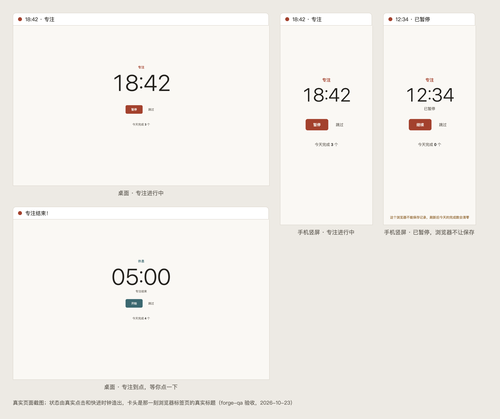

# forge-demo-pomodoro

Forge 示范项目：一个番茄钟网页。

从一句想法「我想做一个番茄钟网页」开始，用 [Forge](https://github.com/antonailog/forge-skills) 的 Skill 一步步做到上线：讨论需求、写 PRD、做设计、写代码、验收、审查、发布、修 bug、复盘。每一步的产物都留在这个仓库里，可以对照着看 Forge 每个 Skill 实际做了什么。

示范过程中需要「用户」拍板的地方由 AI 按事先写好的需求设定代为确认，每一处都有记录。



## 番茄钟能做什么

- 专注 25 分钟、休息 5 分钟，交替进行；随时可以开始、暂停、跳过。
- 到点时响一声短促的提示音，浏览器标签页的标题会交替提示「专注结束！」；点一下页面或按任意键就停。
- 页面上写着今天完成了几个专注；刷新页面不会丢，过了零点从零开始算。
- 打开就能用：不用注册、没有后端，记录只保存在你自己的浏览器里，不会上传到任何地方。
- 手机上也能看。

## 怎么打开

目前没有在线地址，在自己电脑上打开：

1. 下载或克隆这个仓库。
2. 双击仓库里的 `index.html`，用浏览器打开就能用。

也可以在仓库根目录起一个本地静态服务再访问，例如：

```bash
python3 -m http.server 8000
# 然后在浏览器打开 http://localhost:8000/
```

使用时留意三件事：

- **先点一次「开始」才会有提示音**：浏览器要求网页先有人操作过才能出声。
- **标签页放在后台时，提示音可能晚一点响**：浏览器会放慢后台页面，标签页标题的提示照常出现。
- **浏览器不让网页保存数据时**（比如某些隐私模式），页面底部会提示；计时照常，但刷新后今天的完成数会清零。

## 怎么验证

计时规则有单元测试，只需要装好 Node，不用装任何依赖：

```bash
node --test tests/timer-core.test.js
```

在浏览器里的完整验收方法、截图和回归清单见 [docs/QA.md](docs/QA.md)。

## 文件和文档

| 位置 | 是什么 |
|---|---|
| `index.html`、`style.css`、`pomodoro.tokens.css` | 页面结构和样式 |
| `timer-core.js` | 计时规则：开始、暂停、到点、跨零点、恢复记录、页面上的文字 |
| `app.js` | 页面接线：保存记录、走秒、按钮、提示音 |
| `tests/` | 计时规则的单元测试 |
| [docs/modules/番茄钟.md](docs/modules/番茄钟.md) | 给人看的需求设计文档，想了解「为什么这样做」先看这份 |
| [docs/README.md](docs/README.md) | 全部文档入口：需求、设计、工程、验收 |
| [docs/CHANGELOG.md](docs/CHANGELOG.md) | 版本记录 |
