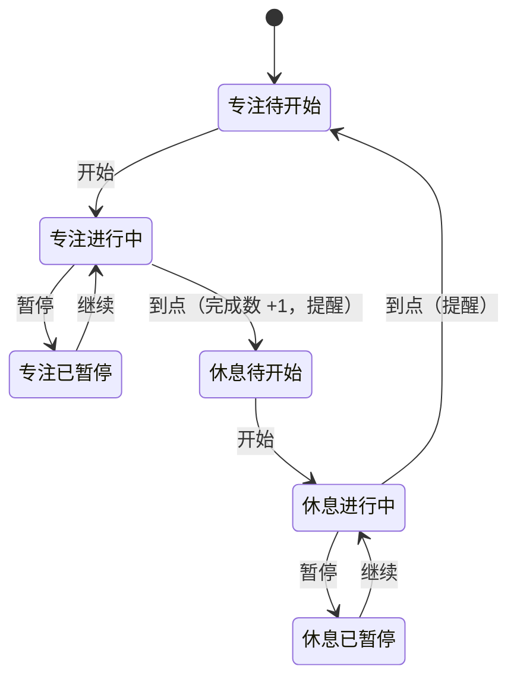

# 番茄钟网页 — 产品需求文档 (PRD)

**版本:** v1.0
**日期:** 2026-10-23
**状态:** 需求已确认，待设计

---

## 迭代历史摘要

### v1.0 — 2026-10-23

- 从零定义产品：专注 / 休息循环计时、开始暂停跳过、到点提醒、今日完成数、保存与恢复、手机可用 — 详见 §三、PRD-CHANGELOG v1.0
- 完整行为契约：[`.features/pomodoro-timer/feature-spec.md`](../.features/pomodoro-timer/feature-spec.md)
- **迭代交付说明**：
  - 前端：新建唯一页面，包含计时区（阶段标签、剩余时间、状态说明）、控制区（主按钮、跳过按钮）、记录区（今日完成数、存储提示）；标签页标题和提示音是页面外的两个提醒出口。
  - 后端：无。不引入任何服务器、接口或账号体系。
  - 设计：交给 `/forge-design` 产出 DESIGN.md；方向是简洁、安静、剩余时间做视觉中心、无花哨动效。需要的视觉稿清单见 Feature Spec 第四节。
  - 验收标准：以 Feature Spec 第五节「验收检查表」为准；其中「后台到点必须响铃」要在真实场景下测（页面在后台、前台在用别的软件），并记录晚响程度。
  - 受影响文件：全新项目，建议结构为项目根目录下的 `index.html` 加同级的样式与脚本文件；全部使用相对路径，保证本地双击打开和以后放到 GitHub Pages 都能用。
  - 关联变更：改计时规则（R1）时同步检查完成数（R2）、提醒（R3）、标题（R4）、保存恢复（R5），这五块共用同一个「当前段」状态。

---

## 一、产品定位

- **一句话**：一个打开就能用的番茄钟网页——专注 25 分钟、休息 5 分钟，到点提醒，随时看到今天完成了几个。
- **给谁用**：需求方自己和几个同事，上班时开在浏览器的一个标签页里。
- **核心价值**：把注意力切成一段段可完成的专注，人不用盯着页面也会被按时提醒；当天的完成数可信——不会因为刷新、误关或浏览器自动重新加载而清零或漏记。
- **不做的前提**：用过网上现成的番茄钟，嫌要注册、有广告、刷新丢记录、功能多余（需求讨论中由需求方确认）。

## 二、信息架构

单页应用，没有路由、没有后端。

**本机保存的数据**（浏览器本地存储，一份记录）：

| 数据 | 含义 |
|---|---|
| 记录日期 | 完成数属于哪一天（本机日期） |
| 当天完成数 | 当天走到点的专注段数量 |
| 当前段 · 阶段 | 专注 / 休息 |
| 当前段 · 状态 | 待开始 / 进行中 / 已暂停 |
| 当前段 · 结束时刻 | 仅进行中时有值 |
| 当前段 · 剩余时长 | 仅已暂停时有值 |

**功能模块**：计时与控制（R1）、今日完成数（R2）、到点提醒（R3）、标签页标题（R4）、保存与恢复（R5）、手机与窄屏（R6）。编号与 Feature Spec 一致。

## 三、核心功能（当前事实）

### 3.1 计时与控制（R1）

- 固定两段循环：专注 25 分钟、休息 5 分钟；没有长休息，时长不可调。
- 主按钮在「开始 / 暂停 / 继续」之间切换；「跳过」在任何状态都可用，直接切到另一阶段的待开始。
- 到点后自动切到下一段，但停在「待开始」，等用户点「开始」。
- 剩余时间一律按「结束时刻 − 当前时刻」计算；显示值不为负、不超过本段完整时长。

### 3.2 今日完成数（R2）

- 只有走到点的专注段算一个；跳过的专注、休息段都不计。
- 按本机日期算「今天」，过零点从零开始；跨零点结束的专注计入新的一天。

### 3.3 到点提醒（R3）

- 响一声短促、安静的提示音；声音在用户点「开始」时解锁。
- 标签页标题在「专注结束！ / 休息结束！」和普通标题之间交替，直到用户在页面上点击或按键。
- 不弹系统通知、不请求通知权限。声音播放失败时不提示错误，靠标题交替兜底。
- 已知边界：页面在后台时铃声可能晚响；手机锁屏期间不承诺提醒。回到页面时立即完成到点处理。

### 3.4 标签页标题（R4）

| 状态 | 标题 |
|---|---|
| 进行中 | `24:59 · 专注` / `04:59 · 休息` |
| 已暂停 | `12:34 · 已暂停` |
| 待开始 | `番茄钟 · 今天 N 个` |
| 到点后等待操作 | 「专注结束！」或「休息结束！」与 `番茄钟 · 今天 N 个` 交替 |

剩余时间放在标题最前面，标签页被挤窄时也看得到。

### 3.5 保存与恢复（R5）

- 刷新、关闭后重开、浏览器自动重新加载后：进行中且未到点 → 接着走；已暂停 → 保持暂停；待开始 → 保持。
- 离开期间已过点：专注段按完成计一个（计在它结束的那一天），切到下一段待开始，不补响铃、标题不交替；如果那段在今天之前就结束了，直接回到「专注 25:00」待开始。
- 想放弃一段只能点「跳过」。
- 浏览器不允许保存时，计时照常，页面底部常驻一行提示「这个浏览器不能保存记录，刷新后今天的完成数会清零」。
- 记录损坏时当作没有记录，不弹错误。
- 同一浏览器开两个页面：各自计时；完成数在保存的最新值上累加，不互相覆盖。

### 3.6 手机与窄屏（R6）

- 同一页面自适应，手机竖屏一屏内能看到全部元素，无横向滚动，按钮好点。
- 不承诺锁屏或切到后台时的提醒；页面被系统回收后按 3.5 恢复。

### 3.7 Feature Spec

完整的用户流程、页面结构、Given/When/Then 场景、异常态和验收检查表见 [`.features/pomodoro-timer/feature-spec.md`](../.features/pomodoro-timer/feature-spec.md)。

## 四、数据模型

- 无数据库、无接口。
- 浏览器本地存储一条记录，字段见 §二。读取失败、内容不合法时按「没有记录」处理并覆盖为合法记录。

## 五、已知问题与改进计划

### P0 — 必须修复
- 无（新项目）。

### P1 — 体验风险
- 后台标签页的到点铃声可能被浏览器推迟。v1.0 先在 QA 里按真实场景实测并记录；如果晚得影响使用，再讨论「用户主动开启的桌面通知」。

### P2 — 后续可能
- 部署到 GitHub Pages（本版不部署）。
- 以下明确不做，除非需求方重新提出：账号、云同步、团队协作、广告、统计图表或历史记录、任务列表、自定义时长、长休息、系统通知、静音开关、键盘快捷键。

## 六、技术约束

- 纯前端静态网页：只有 HTML、CSS、JavaScript，无后端、无构建步骤、无第三方依赖，不从外部网址加载资源。
- 全部使用相对路径：本地双击 `index.html` 能用，放到 GitHub Pages 子路径下也能用。
- 计时按结束时刻计算（浏览器会放慢后台标签页的定时器，逐秒累减会越走越慢）。
- 网页出声需要用户先在页面上操作过：在点「开始」时解锁提示音。
- 目标浏览器：当前主流桌面浏览器和手机浏览器。

## 七、交互流程图

任何状态点「跳过」都切到另一阶段的待开始，不计数、不提醒（为了图面清晰未画出，完整版见 Feature Spec）。

## 八、配色方案 / 九、前端设计系统

由 `/forge-design` 产出 `docs/DESIGN.md` 后在那里维护。本 PRD 只约束方向：简洁、安静，剩余时间是视觉中心，无持续循环的动画，不要营销式大标题首屏。

## 十、技术栈

原生 HTML + CSS + JavaScript；浏览器本地存储保存记录；浏览器自带的音频能力播放提示音。

## 附录：修改清单总结

v1.0 全部为新增：R1 计时与控制、R2 今日完成数、R3 到点提醒、R4 标签页标题、R5 保存与恢复、R6 手机与窄屏。
