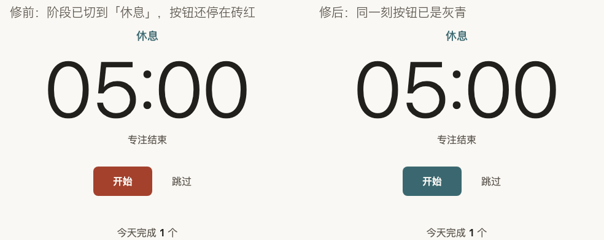
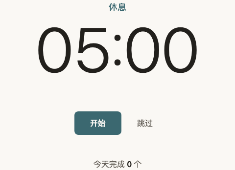
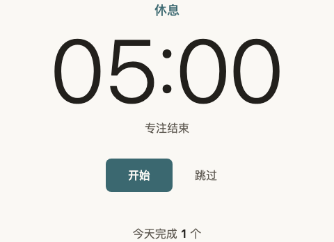
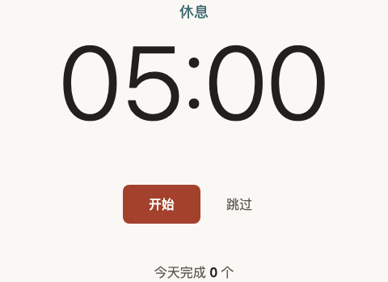
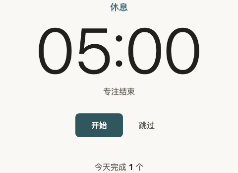
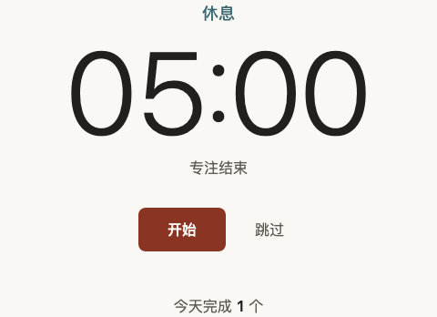
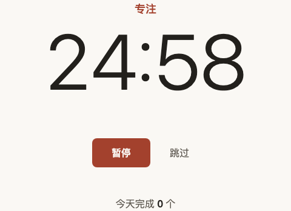

<!--
本报告由 forge-bugfix 从 templates/review-checklist.md 复制而来，是 BF-1023-1 从领取到关闭的过程案卷。
QA 只填第 7、9、10 节；用户只填第 8 节「你的验收」列和第 11 节最终结论。
-->

# BF-1023-1 Bug 修复验收报告

## 1. 当前状态

| 字段 | 内容 |
|---|---|
| 状态 | resolved |
| Bug 描述 | 到点（或点跳过）切换阶段时，主按钮底色不是一下子换掉，而是在一瞬间里慢慢变过去 |
| 来源 | 用户反馈（同一问题 forge-qa 已记为 QA.md 的 BUG-001） |
| 功能域 | 外观 |
| 严重度 | P2 |
| 当前负责人 | d5874570-aea0 |
| 关联批次 | — |

## 2. 问题发现记录

| 字段 | 内容 |
|---|---|
| 发现时间 | 2026-10-23 03:05 |
| 发现环境 | 分支 `eng/pomodoro-timer-2026-10-23`，提交 a632321（QA 验收通过时的版本） |
| 原始描述 | 「到点切换的时候，开始按钮的颜色是慢慢变过去的，不是一下子换掉。设计里写的是直接切换。」 |
| 关联 Feature Spec / 场景 | `.features/pomodoro-timer/feature-spec.md` R1「中途跳过专注」、R2「专注走到点」「休息到点」；设计依据 `docs/DESIGN.md` §5.1「颜色和文字直接切换，无过渡、无闪烁」、§1.2 原则 3「全页唯一的过渡是按钮悬停变色」 |
| 初始影响范围 | 每次切换阶段（专注到点、休息到点、点跳过）主按钮一次；只影响外观，计时、计数、提醒都不受影响 |

### 初始证据

- forge-qa 验收手册 `docs/QA.md` §四 BUG-001：按真实时间连续取色，切阶段后底色经过一串中间色；页面动画列表里出现主按钮的 `background-color` 120ms 过渡。
- 工程文档 `docs/ENGINEERING.md` §九技术债、需求设计文档 `docs/modules/番茄钟.md` 待拍板第 2 条都已记下这处偏离，当时默认「接受现状」。用户这次反馈等于对这条待拍板给出了不同的答案：按设计直接切换。

## 3. 复现记录

| 字段 | 内容 |
|---|---|
| 复现结论 | 已复现（四种切阶段情形全部复现，结果确定，不靠运气） |
| 复现方式 | Playwright：假时钟快进到点 + 冻结页面动画时间线，切换后立即读主按钮底色和正在进行的过渡 |
| 复现命令或入口 | `APP_URL=http://127.0.0.1:4591/index.html node scripts/qa/phase-switch-color.mjs`；本地服务在本 worktree 根目录起（见第 7 节） |

### 复现步骤

1. 打开页面，点「开始」，把鼠标移开按钮。
2. 用假时钟把 25 分钟专注快进完（不真实等待）。
3. 页面切到「休息 05:00」的那一刻读主按钮底色、看主按钮上有没有正在进行的过渡。
4. 同样再看三种情形：点「跳过」切到休息、鼠标一直停在主按钮上时专注到点、休息到点切回专注。

> 为什么不用真实时间：CSS 过渡跟着页面的动画时间线走，不受假时钟控制。脚本用浏览器调试接口把动画时间线的速度设为 0，过渡一旦出现就停在起点——于是切换后读到的底色只有两种结果：直接换掉＝新颜色；有过渡＝还是旧颜色。整套检查不需要任何真实等待，也不会因为机器快慢得出不同结论。

### 复现截图 / 日志

专注到点后：阶段字已经是灰青的「休息」，主按钮却还停在砖红（过渡停在起点）：


点「跳过」后：同样，阶段已切、按钮还是砖红：


修前完整输出（`phase-switch-color.mjs`，修复前代码 a632321）：

```text
FAIL  S1  专注到点切到休息（鼠标不在按钮上）
      切换后不是直接换色：期望底色 灰青、无过渡；实际 阶段=休息，底色=砖红，进行中的过渡=background-color 120ms
FAIL  S2  点「跳过」切到休息
      切换后不是直接换色：期望底色 灰青、无过渡；实际 阶段=休息，底色=砖红，进行中的过渡=background-color 120ms
FAIL  S3  专注到点切到休息（鼠标一直停在主按钮上）
      切换后不是直接换色：期望底色 深灰青、无过渡；实际 阶段=休息，底色=深砖红，进行中的过渡=background-color 120ms
FAIL  S4  休息到点切回专注
      切换后不是直接换色：期望底色 砖红、无过渡；实际 阶段=专注，底色=灰青，进行中的过渡=background-color 120ms
PASS  S5  刷新后恢复到「休息待开始」（边界：页面一打开就是休息阶段）
PASS  G1  鼠标移上主按钮：仍有 120ms 底色过渡，走完是深一档
PASS  G2  鼠标从主按钮移开：仍有 120ms 底色过渡，走完回到阶段色
PASS  G3  主按钮的过渡声明不变：只过渡 background-color 120ms ease-out
PASS  G5  计时进行中鼠标移上主按钮：走秒刷新页面时不打断悬停过渡（只有换阶段才立即换色）
PASS  G4  系统开了「减少动态效果」：悬停和到点都没有过渡
RED：6/10 通过；console.error 0 条
```

S5、G1–G5 是守护项：修复后它们也必须继续通过（刷新恢复不能出过渡；悬停变色的 120ms 过渡不能被一起去掉；页面每秒刷新时不能顺手把悬停过渡也提前结束）。

G5 是定方案后补的：先注入一个故意的坏修法「每次走秒都把过渡走完」（`--variant=finish-every-tick`），确认 G5 会报失败，再信它的「通过」。

## 4. 根因分析

### 假设验证（单变量实验）

QA 已给出根因定位（`style.css` 主按钮常态上的 `transition: background-color`），这次沿用为假设 H1，但先用实验证实，再判断「只改样式」够不够。每个实验只往页面里临时注入一处改动，不改仓库代码，跑同一套检查（`--variant=<名字>`；当时 9 项，G5 是之后补的）：

| 假设 | 实验（只改这一处） | 切阶段 S1–S4 | 刷新恢复 S5 | 悬停过渡 G1–G3 | 减少动效 G4 | 结论 |
|---|---|---|---|---|---|---|
| H1 过渡来自主按钮常态上那条 `transition` | 去掉主按钮的过渡 | 4/4 直接换色 | 通过 | 0/3（悬停也不渐变了） | 通过 | ✅ 证实：去掉它切阶段就直接换；但悬停的过渡也一起没了，不能这么修 |
| H2 只靠样式能分清「悬停」和「切阶段」 | 过渡只写在悬停 / 按下状态上（QA 建议的纯样式改法） | 3/4：**鼠标停在主按钮上时到点仍然渐变** | 通过 | 1/3（鼠标移开时不再渐变，过渡声明也变了） | 通过 | ❌ 否定：样式层分不清这两种变化 |
| H3 由知道「换阶段」的那一层让这次换色立即完成 | 阶段属性一变，就让主按钮正在进行的过渡立即走完 | 4/4 | 通过 | 3/3 | 通过 | ✅ 9/9 全过（补上 G5 后重跑 10/10），作为修复方案 |

H2 失败的原因：浏览器决定「这次变化要不要过渡」只看变化之后的样式，不看变化是怎么来的。「鼠标移上按钮」和「鼠标停在按钮上时换了阶段」变化之后都是「悬停状态的按钮」，样式里写不出区别。

### 5 Whys

1. 为什么出现该现象？到点时主按钮底色的变化走了一次 120ms 的颜色过渡，所以看起来是慢慢变过去的。
2. 为什么会发生这个原因？`style.css` 主按钮常态上写着 `transition: background-color 120ms ease-out`（本来给悬停用），而切阶段改的也是同一个底色属性，只要底色变就会触发过渡，不管是鼠标引起的还是换阶段引起的。
3. 为什么没有被已有逻辑挡住？「换阶段」这件事只有行为代码 `app.js` 知道（它改 `body` 上的阶段属性），样式层看不出底色是为什么变的；而「样式与行为的接口」只约定了行为代码改哪些属性和文字，没有约定「换阶段时颜色要立即到位」由谁负责。
4. 为什么测试没有覆盖到？设计实现阶段只核对了静止状态下的颜色值（每种状态停稳后读色），没有检查「切换那一瞬间」；这一项到 QA 的 V14 才第一次测出来，又按待拍板的默认值被接受了。
5. 根因是什么？悬停变色和阶段换色共用同一个底色属性和同一条过渡声明，样式层无法区分两种变化；需要由知道「换阶段」的行为层在换阶段时让这次换色立即完成。

### 根因结论

主按钮的悬停过渡和阶段换色共用同一个底色属性，样式分不清两者，阶段切换因此也走了 120ms 过渡；只有行为层知道「这次是换阶段」。

### 修复方案（P4.5）

- **A（推荐，已选）**：在 `app.js` 改阶段属性的那一处（`render()` 里只在阶段真正变化时），紧接着让主按钮上正在进行的颜色过渡立即走完；样式不动，`style.css` 只在文件头「样式与行为的接口」里补一句说明这条约定。效果：所有切阶段情形（到点、跳过、鼠标停在按钮上）都直接换色；悬停移上移开仍有 120ms 过渡；DESIGN 不用改。
- **B（备选，不选）**：只改样式，把过渡挪到悬停 / 按下状态上。鼠标停在主按钮上时到点仍会渐变，鼠标移开按钮时也不再渐变——实验 H2 已证明修不全。

### 同类风险扫描

修复后按项目规则 R5 搜了同类模式（会随状态变化的样式 + 过渡声明）：

- 全页只有两条过渡：主按钮（本次修复）和「跳过」按钮。「跳过」的底色和字色只随悬停变化，不随阶段或存储状态变化，**不存在同类问题**。
- 随阶段变化的另一处是阶段标签颜色，它没有过渡，本来就是直接换。
- 随存储状态变化的是底部提示的显示 / 隐藏，没有过渡。
- 行为代码改样式状态的只有 `body` 上的阶段、存储两个属性，没有别的写样式入口。

结论：未发现同类风险，无需另开 bug。

## 5. 修复记录

| 字段 | 内容 |
|---|---|
| Worktree | <仓库根>/.worktrees/bf-1023-1 |
| Branch | bugfix/bf-1023-1（从 eng/pomodoro-timer-2026-10-23 的 a632321 拉出） |
| 修复 commit | 7a4db16 fix(BF-1023-1): 切换阶段时主按钮底色直接换掉，悬停过渡保持 120ms（红灯用例与本报告在 c779081） |
| 涉及文件 | app.js<br>style.css（只改文件头注释）<br>scripts/qa/phase-switch-color.mjs（回归用例，c779081） |
| 修复时间 | 2026-10-23 03:20；合并主线后重新落修复 03:40 |
| 修复摘要 | `app.js` 的 `render()` 只在阶段属性真正变化时，紧接着把主按钮上正在进行的底色过渡立即走完，单独兜住异常、不影响其余更新；`style.css` 样式规则不变，只在「样式与行为的接口」注释里写明这条约定。代码由本机 Codex 按任务书实现（作业 20261023-031624-BF-1023-1），Claude 验收后提交。<br>**合并主线后（6fa6971）**：主线上线前审查把 `render()` 改写成 `setAttr(...)`，并规定 try/catch 只包存储和提示音。合并时 `app.js` 冲突，取主线版本后把返工意见发回同一个 Codex 会话（作业 20261023-033702-BF-1023-1-r1）重新落修复：`setAttr` 改为返回「是否真的改了」，阶段真正变化时走完主按钮的底色过渡；不再用 try/catch，改为先判断浏览器有没有这个接口。 |

## 6. TDD / 回归用例

| # | 用例类型 | 失败证明（修复前） | 通过证明（修复后） | 证据 |
|---|---|---|---|---|
| 1 | Playwright（`scripts/qa/phase-switch-color.mjs`，假时钟 + 冻结动画时间线） | RED：6/10 通过，S1–S4 失败（a632321，见第 3 节输出） | GREEN：10/10 通过，console.error 0（7a4db16） | 修前修后用同一条命令：`APP_URL=http://127.0.0.1:4591/index.html node scripts/qa/phase-switch-color.mjs` |
| 1b | 同一条 Playwright 用例，合并主线后（6fa6971） | — | GREEN：10/10 通过，console.error 0 | 同上命令 |
| 2 | 单元测试（`node --test tests/timer-core.test.js`） | 不涉及（本 bug 不在纯规则模块里，修前也是全过） | GREEN：全过（规则模块未改动，确认没被带坏） | 终端输出 |
| 3 | 正对照（`--variant=finish-every-tick`） | RED：故意的坏修法「每次走秒都把过渡走完」让 G5 失败——证明 G5 能抓到修过头 | — | 第 3 节说明 |

> 规则：每个 bug 必须有独立 TDD 驱动。前端 bug 可用 Playwright 复现断言作为 RED，用修复后的同一断言作为 GREEN。

## 7. 验收入口与环境身份校验

**请使用以下地址验收。forge-qa 也必须使用同一组地址测试。**

| 服务 | 地址 | 来源 | 进程身份校验 | 结论 |
|---|---|---|---|---|
| Frontend | http://127.0.0.1:4591/index.html | 项目没有统一启动入口：forge-bugfix P3.2 在本 worktree 根目录起的静态服务（`python3 -m http.server 4591 --bind 127.0.0.1`），由调用方传入 | PID=22518，cwd=<仓库根>/.worktrees/bf-1023-1，branch=bugfix/bf-1023-1 | PASS |
| Backend / API | — | 纯静态页面，没有后端 | — | N/A |
| API Health | — | 没有接口；页面 `curl` 返回 200 | 200 | N/A |

### 配置 / 开关 / 数据就绪检查

| 检查项 | 实际值 | 预期 | 结论 |
|---|---|---|---|
| Feature flag / config | 项目没有功能开关或配置文件；页面实测主按钮过渡声明 `background-color 0.12s ease-out`（来自 `--pomo-btn-ms: 120ms`） | 120ms 悬停过渡（DESIGN §5.2） | PASS |
| 后端返回状态 | 没有后端 | — | N/A |
| 数据就绪 | 验证项 1–4 从空记录开始，用假时钟造出到点；验证项 5 打开前写入一条「休息待开始」的本机记录 | 能造出四种切阶段情形和刷新恢复 | PASS |

**代码身份**

| 字段 | 内容 |
|---|---|
| Worktree | <仓库根>/.worktrees/bf-1023-1 |
| Branch | bugfix/bf-1023-1 |
| Commit | 第一轮 dba39d8（含修复提交 7a4db16）；第二轮 6fa6971（合并主线后重新落修复，之后只有文档提交） |
| QA 执行时间 | 第一轮 2026-10-23 03:34；第二轮 2026-10-23 03:49 |

**环境一致性结论**：PASS（两轮都只访问上面这个地址；每轮交回前再次核对，监听进程和工作目录未变）

**浏览器证据来源**：Playwright（Claude Code 环境，无头 Chromium）

## 8. 人工验收指南（给用户看）

> 这一节是用户最终验收的主入口。只写用户需要看的页面、操作、预期效果和 QA 参考截图。

| # | 你要检查什么 | 怎么操作 | 预期效果 | QA 参考截图 | 你的验收 |
|---|---|---|---|---|---|
| 1 | 点「跳过」切阶段时，主按钮直接换色 | 1. 打开页面 → 2. 把鼠标放在空白处 → 3. 点「跳过」→ 4. 盯着「开始」按钮 | 按钮一下子从砖红变成灰青，看不到中间色；阶段字同时变成「休息」 | 见第 9 节验证项 1 | PASS（演示代确认，依据第 9 节截图与断言） |
| 2 | 到点切阶段时，主按钮直接换色（就是你反馈的那一刻） | 1. 点「跳过」进入休息 → 2. 点「开始」→ 3. 鼠标移开按钮 → 4. 等休息走完（5 分钟） | 到点那一刻按钮一下子从灰青变回砖红，阶段字变「专注」，状态说明「休息结束」 | 见第 9 节验证项 1 | PASS（演示代确认，依据第 9 节截图与断言） |
| 3 | 边界：鼠标一直停在主按钮上时到点，也直接换色 | 1. 点「开始」后鼠标不要挪开，停在按钮上 → 2. 等到点 | 按钮一下子从深砖红变成深灰青，不经过中间色 | 见第 9 节验证项 2 | PASS（演示代确认，依据第 9 节截图与断言） |
| 4 | 悬停变色仍然是柔和的一下（没被一起改掉） | 1. 鼠标移上「开始」按钮 → 2. 再移开 | 移上时在一瞬间柔和地变深一档，移开时柔和地变回；和修复前一样 | 见第 9 节验证项 3 | PASS（演示代确认，依据第 9 节截图与断言） |
| 5 | 边界：系统开了「减少动态效果」 | 1. 在系统设置里打开「减少动态效果」→ 2. 刷新页面 → 3. 鼠标移上移开主按钮、点「跳过」 | 悬停和切阶段都直接换色，没有任何过渡 | 见第 9 节验证项 4 | PASS（演示代确认，依据第 9 节截图与断言） |

## 9. QA 测试过程与截图证据（forge-qa 填）

**模式**：Mode B（单 bug 修复回归）
**执行时间**：第一轮 2026-10-23 03:34；第二轮（合并主线后）03:49。下面的截图是第二轮在合并后代码上拍的，断言两轮结果一致。
**执行者**：forge-qa（由 forge-bugfix P6 调用）

**怎么测的（不做任何真实时间等待）**：计时用 Playwright 假时钟快进；CSS 过渡跟着页面动画时间线走、不受假时钟控制，所以用浏览器调试接口把动画时间线冻结——过渡一旦出现就停在起点。切换后立刻截图、读按钮底色和正在进行的过渡：直接换色＝已经是新颜色；有过渡＝还停在旧颜色。需要「过渡走完」时直接让它结束，不等。

**自动化测试范围**：
- 按第 8 节人工验收指南逐条走的 Mode B 脚本（验证项 1–4，截图 + 断言），修后页面跑一次；**同一脚本**再对修前提交 a632321 导出的页面跑一次，做修前修后核对。脚本在 `.gstack/qa-reports/BF-1023-1/mode-b.mjs`（本机，不进仓库）。
- 修复自带的回归用例 `scripts/qa/phase-switch-color.mjs`：10/10 通过。
- 规则单测 `node --test tests/timer-core.test.js`：全过。
- 原有验收脚本 `scripts/qa/pomodoro-qa.mjs` 中不需要真实等待的用例：59/59 通过（计时控制、完成数、到点提醒与标题交替、保存与恢复、损坏记录、不能保存、跳过、整轮流程、视觉 token、键盘与读屏）。
- 跳过的原有用例：F07、F12、A01、V04、V05、V09、V10、V14、V15——它们在取色前会真实停顿一下等过渡走完，按本次「不做真实时间等待」的要求不跑。其中与本 bug 相关的 V09（悬停色与过渡声明）、V14（切阶段直接换色）、V15（减少动效）由验证项 1–4 和 `phase-switch-color.mjs` 的零等待检查覆盖；F07、F12 的到点计数和响铃由整轮流程 P01 覆盖。
- 控制台检查：console.error 0；网络错误 0；外部请求 0。

### 9.0 用户问题闭环断言

| 字段 | 内容 |
|---|---|
| 用户原话 / 原始问题 | 「到点切换的时候，开始按钮的颜色是慢慢变过去的，不是一下子换掉。设计里写的是直接切换。」 |
| 最终用户可见结果 | 到点（以及点「跳过」）切换阶段时，「开始」按钮的颜色一下子换成新阶段的颜色，看不到中间色；鼠标移上移开按钮时的柔和变色保持不变 |
| 证明方式 | 切换那一刻冻结动画时间线后截图（按钮已是新颜色）+ 读取按钮底色和正在进行的过渡（验证项 1–4；修前同一脚本失败、修后通过） |
| 结论 | PASS |

修前修后同一刻对比（专注到点，验证项 1 第 4 步）：



#### 验证项 1：切换阶段时主按钮直接换色（跳过、休息到点、专注到点）

**结论**：PASS

**操作轨迹与截图**

1. 打开页面，鼠标放在空白处：「专注 25:00」，按钮砖红。

   

2. 点「跳过」后的那一刻：「休息 05:00」，按钮已是灰青，没有进行中的过渡。

   

3. 点「开始」、鼠标移开，用假时钟快进完 5 分钟休息——到点那一刻：「专注 25:00」「休息结束」，按钮已是砖红。

   

4. 再点「开始」、鼠标移开，快进完 25 分钟专注——到点那一刻（用户反馈的场景）：「休息 05:00」「专注结束」「今天完成 1 个」，按钮已是灰青。

   

**断言**

- 初始：专注 25:00、按钮砖红：PASS
- 跳过后立即：阶段「休息 05:00」、按钮灰青（rgb(59, 104, 112)）、无过渡：PASS
- 跳过后阶段字与按钮同为灰青：PASS
- 休息到点立即：「专注 25:00」、状态「休息结束」、按钮砖红（rgb(163, 65, 45)）、无过渡：PASS
- 专注到点立即：「休息 05:00」、状态「专注结束」、完成数 1、按钮灰青、无过渡：PASS
- 把可能存在的动画全部走完后底色不再变化（没有残留的过渡在等）：PASS
- console.error：0
- network error：0

**Bug 复现核对**：同一脚本跑修前页面，这一项的 5 条切换断言全部失败——跳过后、休息到点、专注到点那一刻按钮都还是旧颜色，带一条 `background-color 120ms` 过渡：



#### 验证项 2：边界——鼠标一直停在主按钮上时到点，也直接换色

**结论**：PASS

**操作轨迹与截图**

1. 点「开始」后鼠标停在按钮上（悬停色走完）：按钮「暂停」，深砖红。

   

2. 鼠标不动，快进到专注到点——到点那一刻：「休息 05:00」「专注结束」，按钮已是深灰青（休息阶段的悬停色）。

   

**断言**

- 悬停中按钮深砖红（rgb(138, 53, 36)）：PASS
- 到点立即：阶段「休息」、按钮深灰青（rgb(48, 87, 94)）、无过渡：PASS
- console.error：0
- network error：0

**Bug 复现核对**：修前同一步按钮还停在深砖红、带 120ms 过渡（这正是只改样式修不掉的那种情形）：



#### 验证项 3：悬停变色仍是 120ms 的柔和过渡；走秒时不被打断

**结论**：PASS

**操作轨迹与截图**

1. 鼠标移上主按钮的那一刻：出现 `background-color 120ms` 过渡（动画时间线冻结，停在起点的砖红）。

   

2. 让悬停过渡走完：深砖红。

   

3. 计时进行中鼠标移上按钮，再走 2 秒（页面刷新 8 次）：「专注 24:58」，悬停过渡仍在进行，没被走秒提前结束。

   

**断言**

- 过渡声明不变：`background-color 0.12s ease-out`：PASS
- 移上时有 `background-color 120ms` 过渡：PASS
- 走完是深砖红：PASS
- 移开时也有 `background-color 120ms` 过渡：PASS
- 移开走完回到砖红：PASS
- 走秒不打断悬停过渡（阶段不变、过渡仍在进行）：PASS
- console.error：0
- network error：0

**修前核对**：修前同一脚本这一项也全部通过——说明修复没有改变悬停的表现。

#### 验证项 4：边界——系统开了「减少动态效果」，悬停和切阶段都直接换色

**结论**：PASS

**操作轨迹与截图**

1. 减少动效下鼠标移上主按钮的那一刻：直接深砖红，没有过渡。

   

2. 点「跳过」、鼠标移开的那一刻：直接灰青，没有过渡。

   

**断言**

- 悬停直接深一档、无过渡：PASS
- 切阶段直接灰青、无过渡：PASS
- console.error：0
- network error：0

#### 验证项 5：刷新恢复与原有功能回归

**结论**：PASS

**操作轨迹与截图**

1. 打开前写入一条「休息待开始」的本机记录再打开页面：直接是「休息 05:00」、灰青按钮，打开时也没有过渡（`phase-switch-color.mjs` S5）。

   

**断言**

- `scripts/qa/phase-switch-color.mjs`：GREEN 10/10（S1–S5 切阶段与刷新恢复直接换色，G1–G5 悬停过渡、过渡声明、走秒不打断、减少动效）：PASS
- `node --test tests/timer-core.test.js`：全过：PASS
- 第二轮（合并主线、修复按主线新写法重新落之后）同一套全部重跑：Mode B 验证项 1–4、`phase-switch-color.mjs`、单测、原有脚本不需真实等待的用例，结果与第一轮一致：PASS
- `scripts/qa/pomodoro-qa.mjs` 不需真实等待的 59 项（含整轮流程 P01：开始 → 专注到点 → 确认 → 休息 → 休息到点 → 确认，每步文字、标题、阶段属性都对、共响两次；P02：6 个状态点跳过都切到另一阶段待开始）：59/59 PASS
- console.error：0
- network error：0

## 10. QA 自动闭环记录（可选）

| 轮次 | 结果 | 处理 | 证据 |
|---|---|---|---|
| 1 | QA_PASS | 进入最终验收（单 bug 模式 P6.5） | 第 9 节；本机完整输出 `.gstack/qa-reports/BF-1023-1/` |
| 2 | QA_PASS | 合并主线后修复代码写法变了（6fa6971），重跑同一套回归；结论不变，用户验收结论沿用 | 第 9 节；本机完整输出 `.gstack/qa-reports/BF-1023-1/round2/`、`.gstack/qa-reports/test-results.json` |

## 11. 最终结论（用户必填一个 x）

- [x] PASS — 全部验证项通过，可以合并/关闭
- [ ] FAIL — 有未通过项（在原 bug 范围内），需要继续修这个 bug
- [ ] PASS + 新发现 — 这个 bug 修好了，但我看到别的问题（在下面“新发现”区列出；AI 会先询问是否入档，再分流到 backlog）

### 新发现（选 PASS + 新发现时必填，一条一行）

_（如选 PASS 或 FAIL，此区留空）_

---

**你填完之后告诉我一声“验收了”，我读报告推进下一步。**

> 演示时由 AI 按默认确认：需求方设定是「简洁、安静，不要花哨动效」，反馈原话要的是「直接切换」。第 9 节修前修后对照里，到点和跳过那一刻按钮已是新颜色、悬停仍柔和变色，五条人工验收项都按 QA 截图和断言判 PASS，最终结论 PASS、没有新发现。第 2、3 条真人验要等满休息或专注时长，演示按「不做真实时间等待」的要求以 QA 的假时钟证据代替。
