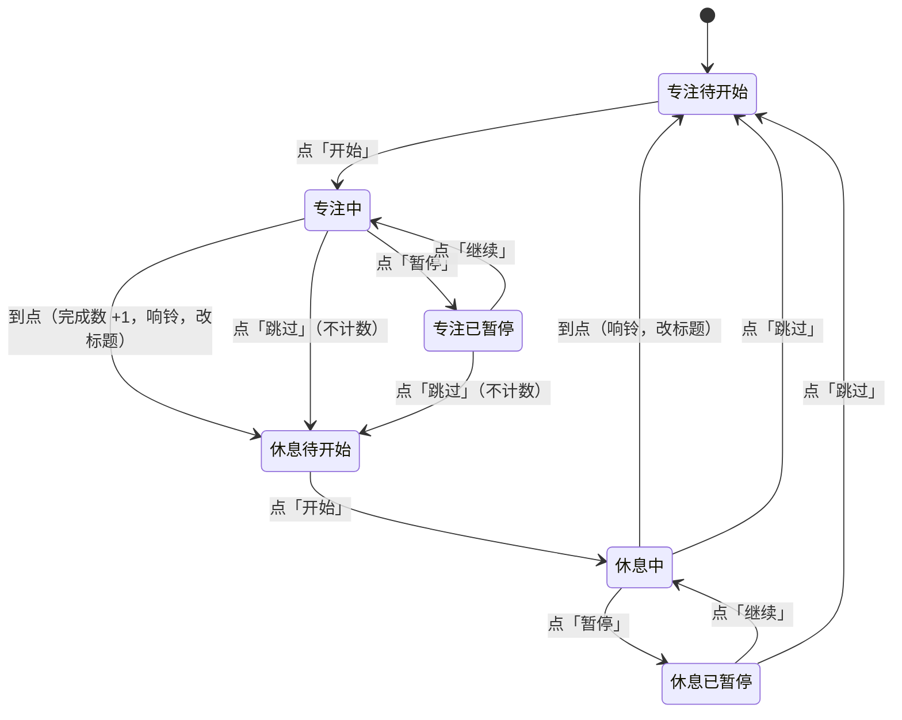

# 需求讨论：番茄钟

**日期**：2026-10-23 · 2026-10-23
**模式**：forge-brainstorm 产品模式
**状态**：✅ 全部锁定（第一轮决策 + 对抗性审查处理，需求方已确认）
**参与者**：需求方（本示范中由 AI 按事先写好的需求设定代答） + Claude

> 本文件是原始讨论记录，不是当前事实源。确认后的结论由 `/forge-prd` 写入 `docs/PRD.md` 和 `.features/` 下的功能规格。

## 0. 如何继续这次讨论（给下一台电脑的自己 / 新会话）

```bash
cd ~/claudecode_workspace/项目/forge-demo-pomodoro
git pull
cat docs/archive/raw/discussions/番茄钟/2026-10-23-番茄钟-需求讨论.md
```

- **进度锚点**：第一轮决策表（§7）已锁定；对抗性审查（§8）的意见已在 §9 逐条处理，**最终决策以 §9.2 为准**；需求方已确认，下一步是 `/forge-prd`。
- **下次第一句话**：「读一下番茄钟需求讨论，按 §9.2 的最终决策写 PRD 和 Feature Spec」。
- 想推翻某条决策时，新开一节「第二轮审视」追加，不改 §7 原文。

## 1. 背景（用户原始描述）

> 我想做一个番茄钟网页，专心工作 25 分钟、休息 5 分钟，能看到今天完成了几个。

## 2. 用户深层痛点

需求方要的不是「一个倒计时」，而是**上班时把注意力切成一段段可完成的专注，并且随时看得到今天已经守住了几段**。所以真正的核心是两件事：到点能被提醒到（不用盯着看），以及当天的完成数可信、不会因为刷新或误关而清零。其余功能都是次要的。

## 3. 竞品 / 参考扫描（景观感知）

**已知层 + 搜索层**：

- 免注册的网页番茄钟已经很多：Tomato Timer、Pomodoro Tracker、番茄工作法官方的网页计时器，以及能直接双击 `index.html` 打开的开源项目 PoTi。共同点是打开即用；差异在于有的要注册才能留记录、有的带任务列表和统计、有的有广告。
- **坑一：后台标签页的计时会被浏览器放慢。** 页面不在前台时，浏览器会降低定时器的执行频率，靠「每秒减一」数出来的倒计时会越走越慢。通行做法是记下「这一段应该在什么时刻结束」，每次刷新显示时用结束时刻减去当前时刻。
- **坑二：网页不能随便自己出声。** 浏览器要求用户先在页面上点过，页面才能播放声音。通行做法是在用户点「开始」的那一下顺手解锁声音；万一还是播不出来，就靠标签页标题变化兜底。
- **坑三：手机锁屏后网页可能被整个挂起**，锁屏期间到点的提醒不保证能响。

**第一性原理层**：番茄钟的价值在于「到点打断你」。所以提醒可靠性比界面好看更重要，而纯网页在后台和锁屏时天生有局限——这是方案选择必须正视的边界，不是实现细节。

参考来源：[Tomato Timer 等免注册番茄钟评测](https://www.online-tech-tips.com/the-3-best-online-pomodoro-applications/)、[番茄工作法官方网页计时器](https://www.pomodorotechnique.com/solutions/pomodoro-timer-web-saas/)、[PoTi 开源番茄钟](https://github.com/code-neves/PoTi)、[后台标签页定时器降频](https://usefulangle.com/post/280/settimeout-setinterval-on-inactive-tab)、[按结束时刻计时避免漂移](https://dev.to/ufebri/build-a-zero-drift-web-timer-3bip)、[Chrome 网页声音自动播放策略](https://developer.chrome.com/blog/web-audio-autoplay)

## 4. 已达成的共识

1. 用的人是需求方自己和几个同事，上班时开在浏览器的一个标签页里。
2. 打开就能用，不注册、不登录。
3. 纯前端静态网页，不要后端；以后可能挂到 GitHub Pages，这次不部署。
4. 明确不要：账号、云同步、团队协作、广告、统计图表大屏。
5. 审美：简洁、安静，不要花哨动效。

## 5. 项目现状扫描

仓库是新建的：只有说明项目来历的 `README.md` 和 forge-doc-policy 刚搭好的文档骨架，没有任何业务代码可以复用。外部可复用的是现成番茄钟网站（见 §3）和浏览器自带的本地存储能力。

## 6. 方案

### 方案 A：单页静态番茄钟（最小可行）

- **核心思路**：一个静态网页，本机浏览器里记当天完成数，只做需求方点名要的东西。
- **做什么**：固定的「专注 25 分钟 / 休息 5 分钟」；开始、暂停、跳过；到点响一声并改变标签页标题；当天完成数刷新不丢；手机浏览器上能正常看和点。
- **不做什么**：自定义时长、长休息、任务列表、历史统计、系统通知、账号与同步。
- **优点**：没有任何依赖，本地打开文件或挂到 GitHub Pages 都能用；范围小到一次就能做完、做稳。
- **缺点**：标签页在后台或手机锁屏时，提醒可能晚到或不响；记录只在这台电脑的这个浏览器里，换设备看不到。
- **适合场景**：自己和同事日常在电脑上开一个标签页用。

### 方案 B：可安装的离线应用（理想版本）

- **核心思路**：在 A 的基础上做成能「添加到桌面 / 主屏幕」的网页应用，补齐提醒和记录。
- **做什么**：A 的全部；外加系统通知、自定义时长、每几个番茄一次长休息、按天的历史列表、离线可用。
- **不做什么**：账号与云同步、团队功能。
- **优点**：系统通知让后台提醒更可靠；手机上更像一个真 App。
- **缺点**：第一次用要弹「是否允许通知」的权限框，正好违背「打开就能用、不打扰」；历史列表已经在往需求方明确不要的「统计」方向走；离线缓存会带来「改了页面用户却看到旧版」这类新问题，复杂度明显上升。
- **适合场景**：用户主要在手机上用，或者非常依赖后台提醒。

### 方案 C：不自己做，直接用现成的免注册番茄钟（侧面方案）

- **核心思路**：番茄钟是成熟品类，直接挑一个现成网站用。
- **做什么**：从 §3 里挑一个，收藏到书签。
- **不做什么**：任何开发。
- **优点**：今天就能用，零成本。
- **缺点**：现成工具要么要注册才能留记录、要么带任务和统计等多余功能、要么有广告，很难同时满足「不注册、刷新不丢记录、没有广告、安静」这几条。
- **适合场景**：只想今天马上开始用，不在乎界面和记录。

### 方案对比：计时状态怎么流转（三个方案的核心都一样）



> **图类型**：Mermaid 状态图 · **决策用途**：让需求方一眼确认「跳过算不算完成」「到点后会不会自动开始下一段」这两条规则 · **状态**：confirmed

### 推荐

推荐**方案 A**。因为需求方明确说了「越简单越好、纯前端、不要后端、简洁安静、不要统计」：B 多出来的系统通知要弹权限框、历史列表越界到统计，换来的只是后台提醒更可靠；C 做不到「不注册也能留记录、没有广告」。A 的唯一硬伤是后台和锁屏提醒不保证，这一点用「到点改标签页标题」兜底，并在需求里写明边界，比引入 B 的复杂度更划算。

## 7. 完整决策表（第一轮锁定）

| # | 决策项 | 结论 | 依据 |
|---|---|---|---|
| D1 | 方案 | 方案 A：单页静态番茄钟 | §6 推荐，需求方确认 |
| D2 | 形态 | 纯前端静态网页，无后端、无账号 | 需求方设定 |
| D3 | 时长 | 专注 25 分钟、休息 5 分钟，固定，不提供设置；没有长休息 | 原话只说了这两个时长；设定未提的按最简单处理 |
| D4 | 控制 | 开始、暂停（再点继续）、跳过（直接进入下一段） | 需求方设定 |
| D5 | 什么算「完成一个」 | 专注段走到点才算一个；跳过专注不算；休息不计数 | 「完成」按字面理解，最不容易引起争议 |
| D6 | 「今天」怎么算 | 按本机日期，过了零点从零开始 | 最简单 |
| D7 | 到点提醒 | 响一声 + 标签页标题变化；不弹系统通知 | 需求方设定；系统通知要弹权限框，违背「不打扰」 |
| D8 | 到点之后 | 自动切到下一段，但停在「待开始」，等用户点开始 | 最不打扰：人不在座位时不会白白开始计时 |
| D9 | 刷新页面 | 当天完成数不丢；正在走的这一段不恢复，回到待开始 | 设定只要求不丢完成记录；恢复计时会引出「关页面期间到点算不算完成」一串规则 |
| D10 | 手机 | 同一个页面自适应，手机浏览器上能看能点；不承诺锁屏后能提醒 | 需求方设定 + §3 坑三 |
| D11 | 审美 | 简洁、安静，无花哨动效 | 需求方设定 |
| D12 | 明确不做 | 账号、云同步、团队协作、广告、统计图表、任务列表、自定义时长、系统通知 | 需求方设定 + D3、D7 |
| D13 | 部署 | 本次不部署；做成可以直接放到 GitHub Pages 的结构 | 需求方设定 |

**实现前提（来自 §3，交给后续阶段）**：倒计时按「结束时刻减当前时刻」计算，不靠累加；声音在用户点「开始」时解锁；声音播放失败时仍要有标题提醒。

## 8. 对抗性审查

（由独立审查者阅读本文 §1–§7 后给出，原文见下。）

### 8.1 最容易失败的点：到点提醒，偏偏这就是核心价值

**问题**：§2 和 §3 都说番茄钟的价值是「到点打断你」，可 D7 只留了「响一声」和「改标签页标题」两条路，也没写做到什么程度才算合格。

**为什么会出事**：

- 按 §4 第 1 条，这个页面是一排标签页里的一个，人通常在别的软件里干活。这时浏览器窗口常被挡住，标题变了也看不见，真正管用的只剩「响一声」。戴着耳机、开会静音、刚好走神，这一声就漏了。D8 又让到点后停在「待开始」，一次没听到，后面的节奏就没人管了。
- §3 的「用结束时刻减当前时刻」只能保证屏幕上的数字准，管不了铃声准不准时。页面在后台时，浏览器会把「检查到没到点」这件事往后推，铃声可能明显晚响。文档却当这个坑已经填上了。
- 讨论里（§10 Q5）得出过「标题是主要信息出口，要随时看得到剩余时间」，这条没写进 §7。§0 说下一步只按 §7 写 PRD，它会直接丢掉。标签一多，标题只露出开头几个字，格式不定下来，这个出口就等于没有。

**改法**：§7 加一条：标题以剩余时间开头，比如「12 分 · 专注」；到点后标题在提示文字和原标题之间来回切换，直到用户回到这个页面。D7 的验收改成实际场景：页面放后台、前台开别的软件，完整走一段专注，铃声必须响，并记下晚了多久。达不到再讨论「用户自己点了才开的桌面提醒」。

### 8.2 最大的盲区：以为只有用户自己会刷新（D9）

**问题**：D9 把刷新当成用户自己的操作，所以觉得正在走的那一段丢了也无所谓。

**为什么会出事**：

- 浏览器自己也会重新加载页面。电脑上标签一多，浏览器会回收很久没看的标签页，点回去时整页重新加载；手机上切出去回条消息，回来也常常是重新加载。番茄钟恰好是「放在后台很久不看」的页面，最容易碰上。
- 结果是：专注走了一大半，切回来页面停在「专注待开始」，这个番茄没算上，用户也不知道为什么。§2 定的核心是「完成数可信」，现在数字是没清零，可该加的没加上，一样不可信。
- D9 说恢复计时会「引出一串规则」，这个理由站不住。§7 的实现前提本来就要记结束时刻，把它存下来几乎不费事，规则一条就够。

**改法**：正在走的一段连同结束时刻一起存下来。重新打开时，还没到点就接着走；已经过点就按 D5 记一个，停在「休息待开始」，不补响铃；暂停中的保持暂停。想放弃一段只能点「跳过」。

### 8.3 只有一半资源：砍掉手机适配（D10）

**问题**：D10 的「手机上能看能点」看着是顺手的事，其实是单独一块活：要做小屏布局、要在几种手机浏览器上实际测试，手机上允许页面出声的规则也和电脑不完全一样。

**为什么该砍**：主要场景是上班时电脑浏览器里的一个标签页，手机不是主战场；而且在手机上核心价值本来就做不到——锁屏后不保证提醒、上班时手机多半静音、手机上平时看不到标签页标题。

**改法**：D10 改成「只保证电脑浏览器；手机能打开、不出错就行」，并当面告诉需求方这是有意取舍。暂停和跳过不要砍。

**另外**：否掉方案 C 的依据（Q2「嫌要注册、有广告、记录会丢」）是 AI 在设定没写到的地方反推的；Q4 也承认没有独到想法。开工前应拿「不注册、刷新不丢记录、没广告、安静」把现成工具逐个对一遍，如果有基本满足的，一半资源时最该砍的其实是「从零开始写」。

## 9. 审查意见处理

> 按「不回填上一轮」的规矩，§7 原文保留不动；下面逐条处理审查意见，被推翻或新增的决策在 9.2 整合，**写 PRD 以 9.2 为准**。

### 9.1 逐条处理

| 审查意见 | 处理 | 理由 |
|---|---|---|
| 8.1 标题格式没进决策表 | **采纳**，新增 D14 | Q5 已经得出「标题是主要信息出口」，漏进决策表是文档缺陷 |
| 8.1 到点后标题要持续提示 | **采纳**，并入 D14 | 一次没听到铃声时，切回浏览器时仍能看到「到点了」 |
| 8.1 后台铃声可能晚响、要按真实场景验收 | **采纳**，修订 D7 | 写进验收：页面放后台走完一段，铃声必须响；晚响的程度记录下来交给后续阶段判断。桌面通知仍不做（要弹权限框） |
| 8.2 浏览器自己也会重新加载页面 | **采纳**，推翻 D9 | 计时本来就按结束时刻算，存下来成本很低；「该加的没加上」同样破坏「完成数可信」 |
| 8.3 砍掉手机适配 | **不采纳** | 「手机上也能看」是需求方点名的必须项。保留 D10 的原边界：手机上能看能点，不承诺锁屏和后台提醒 |
| 8.3 方案 C 的否决依据是 AI 反推的 | **记录为假设** | 由需求方确认（见下方代答）；PRD 里把「为什么不用现成工具」写成显式前提 |

**需求方确认**（演示时由 AI 按需求方设定代答）：手机必须能看，D10 保留；现成工具用过，就是要一个「只有这几样、什么都不多」的，继续方案 A。

### 9.2 整合后的最终决策（PRD 以此为准）

- D1–D6、D8、D10–D13：沿用 §7。
- **D7（修订）到点提醒**：响一声 + 标签页标题变化；不弹系统通知。验收按真实场景：页面在后台、前台开着别的软件，完整走一段，铃声必须响。
- **⚠️ 推翻 §7 的 D9 → D9（修订）刷新与重新打开**：当天完成数不丢；正在走的这一段连同它的结束时刻一起保存。重新打开时：还没到点就接着走；已经过点就按 D5 算完成（专注段记一个，记在它结束的那一天），切到下一段并停在「待开始」，不补响铃；暂停中的保持暂停、剩余时间不变。想放弃一段只能点「跳过」。
- **D14（新增）标签页标题**：标题以剩余时间开头，后跟当前阶段（如「12:34 · 专注」）；暂停时标明已暂停；到点后标题在「到点提示」和普通标题之间交替，直到用户回到这个页面。

## 10. 原始讨论纪实

> 每轮格式：追问 → 选项 → AI 倾向 → 答。本示范中「答」由 AI 按需求方设定代答，每处标注。

### 模式确认

我判断这次讨论适合【产品模式】：要做的是一个给人天天用的工具，需要先把「到底要解决什么、做到哪为止」问清楚。

- A) 产品模式　B) 内容模式　C) 构建模式　D) 探索模式
- **AI 倾向**：A —— 有明确的使用者和使用场景，属于产品功能设计。

**答**（演示时由 AI 按默认确认）：A，产品模式。

### 追问 Q1 — 需求真实性

> 谁在因为这个问题痛苦？不是「用户」——是哪个具体的人，在哪个具体的场景，每周浪费多少时间？

**答**（演示时由 AI 按需求方设定代答）：我自己和几个同事，上班时开在浏览器的一个标签页里用。

### 追问 Q2 — 现状分析

> 他们现在怎么解决的？如果答案是「忍着」或「用 Excel 凑合」——说明痛苦可能没那么大。如果答案是「花钱买了个烂工具」——那才是真需求。

- A) 用手机闹钟 / 计时器凑合　B) 用网上现成的番茄钟，但不满意　C) 没有在用任何工具
- **AI 倾向**：B —— 设定里点名不要账号和广告、要求刷新不丢记录，说明用过且被这些问题烦过。

**答**（演示时由 AI 按默认确认，设定未覆盖，按「必须有 / 不要」反推）：B，用过网上的番茄钟，嫌要注册、有广告、刷新后记录就没了。

### 追问 Q3 — 最窄楔子

> 最小的、有人愿意天天用的版本是什么？砍掉一切 nice to have，只剩什么？

**答**（演示时由 AI 按需求方设定代答）：打开就能用、不用注册；能开始、暂停、跳过；到点有提醒（声音和标签页标题变化）；刷新页面不丢当天的完成记录；手机上也能看。

### 追问 Q4 — 独特洞察

> 你知道什么别人不知道的？为什么是你做这个，而不是已有的 N 个方案？

- A) 有别人没想到的点子　B) 没有，就是现成的都多了我不要的东西
- **AI 倾向**：B —— 设定里全是「不要」清单，没有新玩法。

**答**（演示时由 AI 按默认确认）：B。没有独特洞察，要的就是「只有这几样、什么都不多」。

> AI 判断：没有独特洞察意味着「直接用现成的」是一个必须认真比较的方案，见方案 C。

### 追问 Q5 — 观察性证据

> 有什么观察到的行为（不是访谈）支持这个需求？用户实际在做什么？

**答**（演示时由 AI 按需求方设定代答）：上班时浏览器里本来就开着一排标签页，番茄钟作为其中一个标签页最自然，看一眼标签页标题就知道还剩多久。

> AI 判断：这条直接决定了「标签页标题」是主要的信息出口，不是装饰——到点提醒和剩余时间都应该能在标题上看到。

### 追问 Q6 — 未来适配

> 假设大获成功——3 个月后这个东西长什么样？会不会发现今天的方向是个死胡同？

**答**（演示时由 AI 按需求方设定代答）：可能挂到 GitHub Pages 上让同事直接打开。不会要账号和云同步。

> AI 判断：唯一可能的死胡同是「以后想在多台设备间同步记录」，那需要后端；但需求方明确不要云同步，所以纯静态方案不是死胡同。

### 景观感知

- A) 搜一下　B) 不用，我了解
- **AI 倾向**：A —— 产品模式默认要看现状。

**答**（演示时由 AI 按默认确认：Skill 规定产品模式默认搜索）：A。结果见 §3。

### 前提挑战 1 — 这是正确的问题吗？

> 你要解决的核心问题是「上班时守住一段段专注，并随时看到今天守住了几段」，而不只是「要一个倒计时」，对吗？

**答**（演示时由 AI 按默认确认）：对。

### 前提挑战 2 — 不做会怎样？

> 如果完全不做——半年后会怎样？

**答**（演示时由 AI 按默认确认，设定未覆盖）：继续用现成番茄钟凑合，没什么大损失。

> AI 判断：痛点是轻的，所以范围必须小到一次就能做完，否则不值得做。这条直接支撑了推荐方案 A、并在 D3、D12 里砍掉设置和统计。

### 前提挑战 3 — 已有什么可以复用？

（这一条不问需求方，由 AI 扫项目得出，结论见 §5：仓库里没有可复用代码，外部可复用的是现成番茄钟网站。）

### 方案选择

- A) 方案 A：单页静态番茄钟　B) 方案 B：可安装的离线应用　C) 方案 C：直接用现成的
- **AI 倾向**：A —— 理由见 §6「推荐」。

**答**（演示时由 AI 按默认确认）：A。

### 规则细节（聚焦减法）

> 用「砍掉什么能让核心更强」过一遍：自定义时长、长休息、任务列表、历史统计、系统通知都砍掉；到点后停在待开始；跳过不计数。

**答**（演示时由 AI 按默认确认：设定未覆盖的按最简单、最不打扰处理）：同意，见 §7 的 D3、D5、D7、D8、D9。

### 对抗性审查后的确认（Phase 5.3）

> 思考文档已完成，包含对抗性审查。核心结论：做方案 A，一个只有计时、提醒和当天完成数的静态网页；刷新或浏览器自动重载后，正在走的这一段接着走，不白干；标签页标题是主要的提醒出口。审查最关键的漏洞是「后台提醒可能晚响或被忽略」和「浏览器自己重新加载会吞掉进行中的番茄」，后者已改。
>
> A) 确认，进入下一步　B) 有问题，修改后再确认　C) 需要更深入讨论某个方面　D) 放弃

**答**（演示时由 AI 按默认确认）：A，确认。

### 下一步（Phase 6）

> A) `/forge-prd` — 将思考转化为正式 PRD + Feature Spec（推荐）　B) 存档　C) 继续讨论
>
> 产品模式不允许跳过 PRD 直接开发。

**答**（演示时由 AI 按默认确认）：A，进入 `/forge-prd`。
