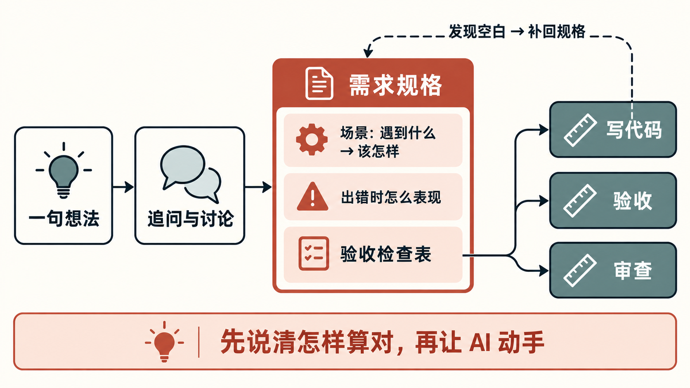
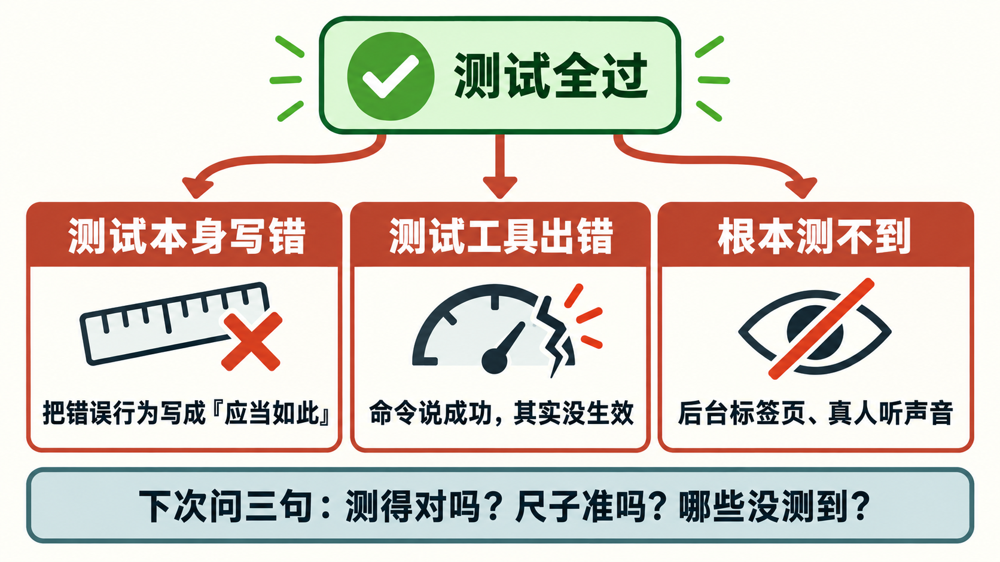

# 复盘：番茄钟从想法到上线——规格先行、换人验收

> 这是 Forge 示范项目的复盘。复盘素材是每个 Skill 跑完后写下的示范记录；文中「用户原话」取自记录里的「用户会怎么说」，各处要用户拍板的地方，示范时由 AI 按需求方设定代答。复盘要学的知识点和深度，由「用户」在复盘工作台的会话页上勾选：选了三个，补充反馈是「读者是想了解用 AI 做一个小项目全过程的普通人：少用术语，多拿番茄钟里的真事举例」。

## 目录

- [一、工作叙事](#一工作叙事)
- [二、表达与行为复盘](#二表达与行为复盘)
- [三、知识拓展](#三知识拓展)
- [四、AI 表现复盘](#四ai-表现复盘)
- [五、速查手册](#五速查手册)
- [TLDR](#tldr)

## 一、工作叙事

需求方只有一句话：想做一个番茄钟网页，专心 25 分钟、休息 5 分钟，能看到今天完成了几个；给自己和几个同事上班时开着用，越简单越好。这次真正要完成的不只是一个网页，而是让 AI 按一套固定流程，从这句想法一路走到合进主分支的成品，并且每一步都留下别人能检查的东西：讨论记录、需求规格、设计文档、验收手册、修 bug 的报告。

过程里有几次关键转折，几乎都是「有人专门挑毛病」挑出来的。头脑风暴时，专门挑刺的审查者指出浏览器自己会重新加载页面，直接推翻了一条「刷新后这一段作废」的规则；写需求时，「到点准时提醒」被改写成「页面在后台也必须响，并记下晚了多久」，因为浏览器会给后台页面的计时限速；设计时，工作台在手机横屏的真实尺寸下量出「专注」两个字会被顶出屏幕；写代码时，又从规格里找出三处没写到的情形，补了回去。

最后交付的是：番茄钟页面合进了主分支（还没有部署到网上），README 和版本记录跟着同步，另外修掉了一个 bug。单元测试全绿、验收也放行之后，上线前审查还是找出了一条测试把错误行为写成了「应当如此」；而验收唯一判为不过的一处——切换阶段时主按钮颜色是慢慢变过去的——在设计实现、写代码、验收三步之间各被记了一笔，谁都没拍板，最后是用户自己当成 bug 报上来，才走修 bug 流程改掉。

回头看，拖慢协作的不是 AI 写不出代码，而是几处「没说清」和「没收口」：开局没把心里早有的硬条件和合格线说出来，验收时没说测不了的怎么办，待拍板的事没人回，中途为了提速砍掉了按真实时间等待的测试，两条并行的工作线又恰好改到同一段代码。这些放在第二章逐条看。

## 二、表达与行为复盘

### 2.1 逐条 Prompt 分析

#### #P1: "我有个想法，想做一个番茄钟网页，专心工作 25 分钟、休息 5 分钟，能看到今天完成了几个。帮我想想。"

- **表达问题**：心里早有的硬条件——不用注册、刷新不丢记录、手机上能看、不要账号和广告——一条没说，AI 靠六轮追问才挖出来；「到点提醒」做到什么程度算合格也没说，是挑刺的审查者后来补问出来的。相关知识：[K1 先写需求规格和验收检查表](#k1)。
- **更好的说法**：
  - **低关键词版**：想做一个番茄钟网页，给我和几个同事上班开着用。必须有：打开就能用、不用注册、刷新不丢今天的记录、手机上能看。不要：账号、云同步、广告、统计大屏。到点提醒做到「在别的标签页也能听到」就算合格。帮我想想还缺什么。
  - **进阶版**：先按产品模式追问，但以下约束已定、不用再问：必须有……；非目标是……；到点提醒的验收标准是「后台也必须响、只响一次」。追问完把每个功能写成「在什么情况下、做了什么、应该看到什么」的场景，再列验收检查表。

#### #P2: "设计定了，开始开发吧。"

- **表达问题**：没说验收时「小偏离」怎么判。后来唯一不过的那处按钮颜色过渡，在设计实现、写代码、验收三步之间传了一圈，每步都记一笔、没人拍板，最后靠调度的 AI 临时定的「只剩可接受的已知问题就放行」才过关。相关知识：[K2 写代码的和验收的要分开](#k2)、行为 [B1](#b1)。
- **更好的说法**：
  - **低关键词版**：开始开发。验收时只要有一处和设计不一样，哪怕很小，也停下来给我看截图，我来定改不改，不要默认放过。
  - **进阶版**：开始开发；验收关卡：严重和高级别问题一律打回修；低级别的设计偏离列进待拍板，阶段结束前由我拍板，不允许默认「接受现状」。

#### #P3: "功能做完了，帮我验收一下：按需求里的检查表一条条测，到点提醒在后台到底准不准也测一下，有问题列出来，别动代码。"

- **表达问题**：「到底准不准」没有合格线，也没说测不了怎么办。无头浏览器（没有窗口、由程序操控的浏览器）里页面永远「在眼前」，真实的后台场景测不出来，QA 只能自己设计替代测法，再把手动步骤交回给你。相关知识：[K3 测试全过，为什么还会有问题](#k3)。
- **更好的说法**：
  - **低关键词版**：页面在后台时，到点晚响一分钟以内我能接受。你那边测不了的，写清楚用了什么替代办法、和真实情况差在哪，再给我一份我自己能照着做的手动步骤。
  - **进阶版**：后台到点的验收标准是：必须响、只响一次、晚响不超过一分钟；自动化测不到的项标「部分验证」，写明测法和真实场景的差距，并列进需求方手动验证清单。

#### #P4: "到点切换的时候，开始按钮的颜色是慢慢变过去的，不是一下子换掉。设计里写的是直接切换。修一下。"

- **表达问题**：现象、期望、依据都说清了，本身是一条好反馈。问题在时机和边界：这一项早就在需求设计文档的「待拍板」里，默认「接受现状」，你没去回那条待拍板，而是绕到修 bug 流程里推翻它；也没说鼠标放在按钮上时那种柔和变色要不要保留，AI 只能自己猜着加了几条「别把悬停效果一起改掉」的守护检查。相关行为：[B1](#b1)。
- **更好的说法**：
  - **低关键词版**：待拍板里「按钮颜色过渡」那条我不接受：换阶段时要一下子换色；鼠标放上去时的柔和变色保留。按 bug 修。
  - **进阶版**：回复待拍板：切换阶段时主按钮直接换色（对齐设计文档），悬停过渡保持不变并作为回归守护项；按修 bug 流程走，验收要覆盖「鼠标停在按钮上时刚好到点」。

### 2.2 行为诊断

#### B1：待拍板不回，默认值替你做了决定

- **问题**：AI 把拿不准的事放进「待拍板」，并附上一个默认答案（多半是「接受现状」）。没人回，默认值就悄悄生效；等后面的环节按另一套标准判它不合格，事情就开始在几个环节之间来回传。按钮颜色过渡就是这样：设计实现引入、写代码那一步记进待拍板并默认接受、验收判为失败又交回设计，最后由用户以 bug 的形式推翻。
- **分析**：原因是流程惯性加验收缺失。待拍板放在文档里，不打断工作，很容易被当成「以后再说」；而默认值写着「你不回就按此」，看起来像已经处理了。每个环节都只负责「记下来」，没有一个环节负责「收口」。
- **建议**：把「清待拍板」变成每个阶段结束时的固定动作：阶段交付时让 AI 把待拍板逐条列出来，你当场回「同意默认」或「不同意，改成……」。不同意的，直接回在待拍板上，再说「按 bug 修」，而不是另起一个反馈。

#### B2：测不了的项交给「以后手动验」，但没人去验

- **问题**：页面在后台时到点晚响多久、电脑合盖睡眠后、手机锁屏、提示音到底听不听得见、Safari 和 Firefox 上表现如何——这些都被老老实实写成「部分验证」，列进了需求方手动验证清单，然后项目就合并发布了，清单没人走过。中途为了提速，又定下「不再做按真实时间等待的测试」，修 bug 时有两条本该由真人等满一段时长再看的验收项，也改用了快进时钟的证据代替。
- **分析**：原因是验收缺失加注意力偏移。自动化验收的报告写得很完整，满屏「通过」，容易让人把「部分验证」也读成「通过」；提速决定只说了「不做什么」，没说被砍掉的验证项由谁、什么时候补。
- **建议**：发布前只问一句「哪些是部分验证、还没人验过？」，然后二选一：挑最关键的两三项自己花几分钟走一遍（比如开着番茄钟切到别的软件，到点看表），或者明确说「这几项我接受风险，写进已知限制」。中途改规矩提速时，同时让 AI 列出「因此没测的项」。

#### B3：并行开工前没问「会不会改到同一处」

- **问题**：为了提速，上线前审查和修 bug 两条线同时跑。登记表显示修 bug 那一块「没人占用、可以并行」，可审查恰好改写了 bug 所在的那段代码，还定了一条新规矩（只在存储和声音两处捕获错误）。修复合进主线时起了冲突，只能按新规矩重写一遍、重跑全部回归。
- **分析**：原因是规范缺失。并行登记只有修 bug 流程会写，审查、发布这些主线环节不登记，所以登记表看不见真正的撞车；而决定并行的人只想到「两件事不相关」，没想到「两件事会改同一个文件」。
- **建议**：开第二条线之前让 AI 回答两个问题：这两条线各自会改哪些文件，有没有重叠；如果有，谁先合、后合的一方合并主线后要重跑哪些检查。

## 三、知识拓展

### K1：先写需求规格和验收检查表 [来自 #P1 / 本次实践]

#### 是什么

需求规格，就是在动手之前把「做成什么样算对」写下来。番茄钟这次用的写法分三块：

- **场景**：用「在什么情况下 → 做了什么 → 应该看到什么」三段话描述每个功能。比如「正在专注、还剩几分钟 → 刷新页面 → 页面接着倒数，不从头开始」。这种写法在软件行业叫 Given / When / Then，来自行为驱动开发，好处是每一条都能直接判对错。
- **出错时怎么表现**：浏览器不让保存记录时页面上显示什么、同时开了两个页面算几个、跨过零点「今天完成数」怎么算。顺利的情况人人都想得到，出错的情况才最容易漏。
- **验收检查表**：把上面的内容压成一条条能打勾的检查项，写代码的、验收的、审查的都拿这同一张表当尺子。

Claude Code 官方的使用建议里也有同样的做法：大一点的功能，先让 AI 追问你、再写一份完整的规格；最有用的规格要写清「不做什么」，并以一个能证明功能真的可用的检查步骤结尾。

#### 怎么用

本次实践里，规格是后面每一步的共同依据：写代码的 AI 逐条照着实现，验收逐条测，审查逐条对口径。它还有一个容易被忽略的作用——暴露空白。写代码时从规格里找出了三处没写到的情形：两个页面恢复的是同一段专注时各自到点算几个、到点提示在刷新后还留不留、刚好到点那一刻按下按钮算什么。按项目规则，这类空白要停下来告诉用户，而不是由 AI 自己拍板；最后三处都取「最简单、最不打扰用户」的做法补回了规格。

什么时候用：功能要交给别人（包括另一个 AI）做，或者不止一句话能说清的改动。什么时候不用：改个错字、加一行日志这种一句话就能描述的小改动，直接让 AI 做就行。回到 [#P1](#p1)。

**关键词**：需求规格（Feature Spec）、验收标准（acceptance criteria）、Given / When / Then、非目标（不做什么）、边界情况。

**下次可以怎么说**：「先别写代码。把每个功能按『在什么情况下、做了什么、应该看到什么』写成场景，单独写出出错时的表现，最后列一张能逐条打勾的验收检查表，写明不做什么。我确认后再开工；写代码时发现规格没写到的，停下来问我。」

**常见误区**：

- 把规格写成形容词，比如「要准时」「要好用」——判不了对错。这次 PRD 就把「准时提醒」改成了「后台也必须响，并记下晚了多久」。
- 以为规格写完就不动了——实现时发现的空白要补回规格，规格要跟着变。
- 只写顺利的情况——这次真正花功夫的，几乎都是出错和边界情况。

#### 延伸学习

- [Claude Code 官方最佳实践：Let Claude interview you](https://code.claude.com/docs/en/best-practices#let-claude-interview-you)：看「让 AI 先追问你、再写规格」的提问模板，以及好规格应该包含什么。
- [Martin Fowler：Given When Then](https://martinfowler.com/bliki/GivenWhenThen.html)：一页讲清三段式场景的来历和写法，适合第一次接触的人。
- [GitHub Spec Kit](https://github.github.com/spec-kit/)：GitHub 开源的「规格先行」工具包，看它把「规格 → 计划 → 任务 → 实现」拆成几步，了解这套思路在 AI 写代码里的通用做法。

### K2：写代码的和验收的要分开 [来自 #P2 / 本次实践]

> 图像待生成：已保存 prompt pack 到 `assets/2026-10-23-fupan-k2-separate-verifier.prompt.md`（示范为控制生图数量只出两张）

#### 是什么

写代码的一方，天然倾向于认为自己写对了；它顺手写的测试，也带着同样的理解。所以要把「写」和「查」交给不同的执行者：查的一方只看结果和事先写好的标准，而且目标不是确认「它说全过了」，而是想办法证明它错。

Claude Code 官方文档把这叫作「写的人不给自己打分」：可以让一个新开的 AI 去复核结果、试着推翻它；也可以开两个会话，一个写、一个审，因为新的上下文不会偏向自己刚写的代码。

#### 怎么用

本次实践里，代码由 Codex 写，Claude 负责写任务书、定验收标准、亲自验收。验收不是看 Codex 的汇报，而是做了三件「证伪」的事：

- **换成空壳**：把实现换成什么都不做的版本，测试必须全部失败——否则说明这些测试什么都没测。
- **故意改坏**：把关键规则逐处改坏，比如去掉「同一段专注只算一次」，每一处都必须有测试报警。业界把这种做法叫变异测试。
- **独立再写一份检查**：按规格自己写一套，不用 Codex 的测试。

之后 QA 又按验收检查表从头测了一遍，上线前审查再看一遍。还有一个细节：Codex 的工作环境里打不开浏览器，页面好不好看、和设计对不对得上，全靠 Claude 截图和比对脚本把关——查的一方往往需要写的一方没有的工具和视角。回到 [#P2](#p2)。

什么时候用：AI 写的代码要交给别人用；测试是写代码的 AI 自己写的。什么时候可以轻一点：一行的小改动，跑一下现成的检查就够了。

**关键词**：写的一方 / 查的一方（Writer / Reviewer）、独立验收、证伪、空壳测试、变异测试（mutation testing）、能判对错的验收标准。

**下次可以怎么说**：「这个功能让 A 写，你来验收。验收标准先写成能判对错的条目交给它；它交回后别只看它说全过：把实现换成空壳，看测试会不会全失败；再把关键规则故意改坏，看测试能不能抓到。」

**常见误区**：

- 让同一个 AI「写完自己检查一下」——它会用同样的理解去查，查不出理解本身的错。
- 查的一方只看汇报——这次调度的 AI 收到子任务的汇报后，每个统计数字都自己重新核了一遍才写进记录。
- 以为分开就万事大吉——查的一方用的工具也会出错，见 [K3](#k3)。

#### 延伸学习

- [Claude Code 官方最佳实践：Give Claude a way to verify its work](https://code.claude.com/docs/en/best-practices#give-claude-a-way-to-verify-its-work)：看「给 AI 一个能跑的检查」和「让另一个 AI 去推翻结果」两部分；同一页的 [Add an adversarial review step](https://code.claude.com/docs/en/best-practices#add-an-adversarial-review-step) 讲怎么让审查者只报真正影响正确性的问题。
- [Stryker：What is mutation testing?](https://stryker-mutator.io/docs/)：变异测试工具的官方说明，一页讲清「往代码里故意放 bug，看测试抓不抓得到」。

### K3：测试全过，为什么还会有问题 [来自 #P3 / 本次实践]

#### 是什么

「测试全过」只说明一件事：代码符合测试。而测试是人（或 AI）写的，所以还有三个漏洞：

- **测试本身写错了**：上线前审查发现，把电脑时间往回调之后点暂停，页面会把剩余时间存成比一整段还长，点「继续」数字却不动。更要紧的是，有一条测试恰好把这个错误写成了期望结果——代码和测试错得一模一样，所以全绿。
- **测试工具自己出错**：验收时想模拟电脑睡眠，用了浏览器调试工具里一个「冻结页面」的命令，命令回报成功，页面其实照常在走，量出来的结果只能作废。写代码阶段的验收脚本也错过几次（时间算错、等得太短）。
- **有些情况根本测不到**：浏览器会给后台标签页的计时限速，页面隐藏久了，一些定时器每分钟才被检查一次，所以番茄钟在后台时到点可能晚响。可是无头浏览器里页面永远「在眼前」，这个场景测不出来；提示音也只能证明「发出了一声」，没有人真的听过。

#### 怎么用

这次单元测试全绿、验收也放行之后，审查仍然找出了问题，就是第一种漏洞；QA 自己的工具出错，是第二种；后台到点、真人听声音、Safari 和 Firefox，是第三种——QA 老实地标成「部分验证」，把手动步骤交给了需求方。回到 [#P3](#p3)。

以后看任何验收结果，先问三句：

- **测得对吗？** 测试里写的期望，和规格对得上吗？
- **尺子准吗？** 新写的检查，有没有先拿一个已知结果的样本跑过，确认它会报错？
- **哪些没测到？** 报告里有没有「部分验证」「转人工」？这些不是失败，但也不是通过：要么自己走一遍，要么明确接受风险。

暂时不用深入：覆盖率数字怎么算、变异测试工具怎么配、浏览器限速的具体规则。知道「全过不等于没问题」、会问上面三句，就够用了。

#### 延伸学习

- [Martin Fowler：Test Coverage](https://martinfowler.com/bliki/TestCoverage.html)：讲「覆盖率数字说明不了测试好坏」，适合理解为什么不能只看「全过」和百分比。
- [Chrome 官方博客：Heavy throttling of chained JS timers](https://developer.chrome.com/blog/timer-throttling-in-chrome-88)：浏览器为什么、在什么条件下给后台页面的计时限速，解释番茄钟在后台为什么可能晚响。
- [Claude Code 官方最佳实践：Avoid common failure patterns](https://code.claude.com/docs/en/best-practices#avoid-common-failure-patterns)：看其中「先信任再验证」那条：看起来对的实现常常漏掉边界情况，验证不了就别发布。

未展开候选（这次没选）：修 bug 先做实验找根因；让 AI 专门挑自己的毛病；在真实尺寸上定设计；假时钟：怎么测和时间有关的功能；几个 AI 并行干活怎么不撞车。

## 四、AI 表现复盘

#### A1：验收工具自己出错，事后排查才发现

- **表现**：写代码阶段，Claude 的验收脚本错过三次（一次时间算错、两次等得太短）；验收阶段，「冻结页面」的命令回报成功、实际没生效，第一版测量结果作废；还有一处测法本身不对（对已经用键盘选中的按钮再点鼠标，浏览器本来就会保留焦点框）。好在每次都是先怀疑工具、修好工具再重测，没有把工具的错记成页面的 bug。修 bug 阶段有明显进步：新加的检查先用一个故意写坏的修法证明它会报失败，才信它的「通过」。
- **原因**：验证不足。新写的检查在第一次使用前，没有先拿已知结果的样本证明它能区分好坏。
- **用户可辅助方式**：给 AI 派验收时加一句：「新写的检查脚本，先用一个已知是坏的样本跑一遍，证明它会报失败，再拿来测正式代码。」

#### A2：同一处偏离传了一圈，没有人收口

- **表现**：按钮颜色过渡是设计实现那一步引入的；写代码那一步看见了，但按分工不能改样式，只记进待拍板并默认接受；验收判为低级别失败，又写「交给设计拍板」；调度的 AI 也没有「谁来改设计文档」的规则。三个环节各记一笔，直到用户以 bug 的形式提出才修。
- **原因**：遗漏。每个环节都把「记录问题」做到了，但没有一个环节被要求「把问题带到拍板」；AI 把「已经写进待拍板」当成了「已经处理」。
- **用户可辅助方式**：开工时说清「待拍板由谁、在哪一步收口」，例如：「每个阶段交付时，把新增的待拍板列在汇报第一屏，等我回复再进下一步。」

#### A3：照流程字面执行，会给出和实际不符的结论

- **表现**：查「谁在跑」时，流程的第一步只看一张登记表，表里没有记录，就输出「还没用过并行」——而当时另一个会话正在验收；上线前审查按流程的比较方式，把主线后来补的状态更新当成了「分支删掉的内容」；发布后同步文档时，新拉的分支和主线没有差别，按流程什么都看不到。三次都是 AI 拿实际情况一核对，发现不对，再改用别的方法补判。
- **原因**：流程规则有遗漏，AI 一开始照字面执行、先给结论后核对。
- **用户可辅助方式**：看到 AI 给出「没有」「一切正常」这类结论时，追问一句：「这个结论是根据什么得出的？和你看到的实际情况对得上吗？」

**对照复盘账本里已有的通用教训**：🟢「新写的检查先用已知结果验一遍」——修 bug 阶段做到了，写代码和验收阶段工具出错时也是先查工具再下结论；🟢「一说『准时、一定』就要换成可验收的说法」——需求阶段把「准时提醒」改写成了「后台也必须响，并记下晚了多久」；🟢「发布汇报把提交、推送、合并、部署分开写」——发布总结里写明了「部署：未执行」。这次没有发现老毛病复发。

## 五、速查手册

| 概念 | 解释 | 场景 |
|------|------|------|
| 需求规格（Feature Spec） | 写给 AI 和验收者看的「做成什么样算对」：每个功能的场景、出错时的表现、验收检查表。它不是给人看的说明书，而是后面每一步共用的尺子 | 番茄钟写代码、验收、审查都以它为准 |
| Given / When / Then | 场景的三段式写法：在什么情况下、做了什么、应该看到什么。每一条都能直接判对错，容易误解成「格式要求」，其实重点是「能判对错」 | 规格里每块功能的场景 |
| 验收检查表 | 把规格压成一条条能打勾的检查项。验收报告要对每一条给出「通过 / 部分验证 / 失败」和证据 | QA 逐项测的依据 |
| 待拍板 | AI 拿不准、需要你决定的事，通常附一个默认答案。没人回，默认值就会生效 | 按钮颜色过渡默认「接受现状」，后来被推翻 |
| 写的一方 / 查的一方 | 写代码和验收交给不同执行者，查的一方只看结果和标准，并设法证明它错 | Codex 写、Claude 验收、QA 再独立测 |
| 空壳测试 | 把实现换成什么都不做的版本，测试应该全部失败；不失败说明测试没在测东西 | 验收计时规则时的第一步 |
| 变异测试 | 把代码里的关键规则故意改坏，看测试能不能抓到；抓不到说明测试有漏洞 | 去掉「同一段只算一次」等改动，逐一验证测试会报警 |
| 部分验证 | 能测的测了，但和真实使用情况有差距，需要人补测或明确接受风险。不是失败，也不是通过 | 后台到点、真人听声音、Safari 和 Firefox |
| 假时钟 | 测试时让浏览器里的时间可以快进，不用真等。它管不到动画，也模拟不了「页面在后台」 | 把 25 分钟专注快进完来验到点逻辑 |
| 合并请求 | 把一条分支上的改动合进主线前开的「申请」，附上改了什么、怎么测的；合并前主线变了，要重新验 | 功能、文档、修 bug 各走了一次合并请求 |

## TLDR

- **需要记住的知识**：先写「怎样算对」再让 AI 动手——场景写成「在什么情况下、做了什么、应该看到什么」，再列一张能逐条打勾的验收检查表，写明不做什么。
- **需要记住的知识**：写代码的和验收的要分开；验收不是看它说全过，而是把实现换成空壳、把规则故意改坏，看测试会不会报警。
- **需要记住的知识**：测试全过只说明「代码符合测试」。看验收结果先问三句：测得对吗？尺子准吗？哪些没测到？
- **需要记住的知识**：「部分验证」不是通过。发布前要么自己走一遍，要么明确接受风险、写进已知限制。
- **表达优化**：下次可以说：「想做一个番茄钟网页，给我和几个同事上班用。必须有……；不要……；到点提醒做到……就算合格。帮我想想还缺什么。」
- **表达优化**：下次可以说：「自动化测不到的项，写清用了什么替代测法、和真实情况差在哪，再给我一份我能照着做的手动步骤。」
- **协作 SOP**：开局给「必须有 / 不要 / 合格线」→ 让 AI 追问并写规格和验收检查表 → 一个 AI 写、另一个 AI 按检查表验收 → 每个阶段结束时清掉待拍板 → 发布前处理所有「部分验证」的项。
- **协作 SOP**：并行开两条线之前，先问「两条线会不会改到同一个文件」；会的话定好谁先合，后合的一方合并主线后重跑全部检查。
