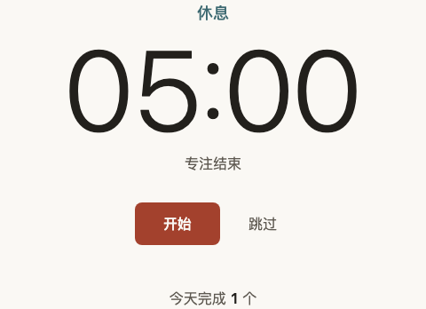

<!--
本报告由 forge-bugfix 从 templates/review-checklist.md 复制而来，是 BF-1023-1 从领取到关闭的过程案卷。
QA 只填第 7、9、10 节；用户只填第 8 节「你的验收」列和第 11 节最终结论。
-->

# BF-1023-1 Bug 修复验收报告

## 1. 当前状态

| 字段 | 内容 |
|---|---|
| 状态 | in-progress |
| Bug 描述 | 到点（或点跳过）切换阶段时，主按钮底色不是一下子换掉，而是在一瞬间里慢慢变过去 |
| 来源 | 用户反馈（同一问题 forge-qa 已记为 QA.md 的 BUG-001） |
| 功能域 | 外观 |
| 严重度 | P2 |
| 当前负责人 | d5874570-aea0 |
| 关联批次 | — |

## 2. 问题发现记录

| 字段 | 内容 |
|---|---|
| 发现时间 | 2026-10-23 03:05 |
| 发现环境 | 分支 `eng/pomodoro-timer-2026-10-23`，提交 a632321（QA 验收通过时的版本） |
| 原始描述 | 「到点切换的时候，开始按钮的颜色是慢慢变过去的，不是一下子换掉。设计里写的是直接切换。」 |
| 关联 Feature Spec / 场景 | `.features/pomodoro-timer/feature-spec.md` R1「中途跳过专注」、R2「专注走到点」「休息到点」；设计依据 `docs/DESIGN.md` §5.1「颜色和文字直接切换，无过渡、无闪烁」、§1.2 原则 3「全页唯一的过渡是按钮悬停变色」 |
| 初始影响范围 | 每次切换阶段（专注到点、休息到点、点跳过）主按钮一次；只影响外观，计时、计数、提醒都不受影响 |

### 初始证据

- forge-qa 验收手册 `docs/QA.md` §四 BUG-001：按真实时间连续取色，切阶段后底色经过一串中间色；页面动画列表里出现主按钮的 `background-color` 120ms 过渡。
- 工程文档 `docs/ENGINEERING.md` §九技术债、需求设计文档 `docs/modules/番茄钟.md` 待拍板第 2 条都已记下这处偏离，当时默认「接受现状」。用户这次反馈等于对这条待拍板给出了不同的答案：按设计直接切换。

## 3. 复现记录

| 字段 | 内容 |
|---|---|
| 复现结论 | 已复现（四种切阶段情形全部复现，结果确定，不靠运气） |
| 复现方式 | Playwright：假时钟快进到点 + 冻结页面动画时间线，切换后立即读主按钮底色和正在进行的过渡 |
| 复现命令或入口 | `APP_URL=http://127.0.0.1:4591/index.html node scripts/qa/phase-switch-color.mjs`；本地服务在本 worktree 根目录起（见第 7 节） |

### 复现步骤

1. 打开页面，点「开始」，把鼠标移开按钮。
2. 用假时钟把 25 分钟专注快进完（不真实等待）。
3. 页面切到「休息 05:00」的那一刻读主按钮底色、看主按钮上有没有正在进行的过渡。
4. 同样再看三种情形：点「跳过」切到休息、鼠标一直停在主按钮上时专注到点、休息到点切回专注。

> 为什么不用真实时间：CSS 过渡跟着页面的动画时间线走，不受假时钟控制。脚本用浏览器调试接口把动画时间线的速度设为 0，过渡一旦出现就停在起点——于是切换后读到的底色只有两种结果：直接换掉＝新颜色；有过渡＝还是旧颜色。整套检查不需要任何真实等待，也不会因为机器快慢得出不同结论。

### 复现截图 / 日志

专注到点后：阶段字已经是灰青的「休息」，主按钮却还停在砖红（过渡停在起点）：



点「跳过」后：同样，阶段已切、按钮还是砖红：


修前完整输出（`phase-switch-color.mjs`，修复前代码 a632321）：

```text
FAIL  S1  专注到点切到休息（鼠标不在按钮上）
      切换后不是直接换色：期望底色 灰青、无过渡；实际 阶段=休息，底色=砖红，进行中的过渡=background-color 120ms
FAIL  S2  点「跳过」切到休息
      切换后不是直接换色：期望底色 灰青、无过渡；实际 阶段=休息，底色=砖红，进行中的过渡=background-color 120ms
FAIL  S3  专注到点切到休息（鼠标一直停在主按钮上）
      切换后不是直接换色：期望底色 深灰青、无过渡；实际 阶段=休息，底色=深砖红，进行中的过渡=background-color 120ms
FAIL  S4  休息到点切回专注
      切换后不是直接换色：期望底色 砖红、无过渡；实际 阶段=专注，底色=灰青，进行中的过渡=background-color 120ms
PASS  S5  刷新后恢复到「休息待开始」（边界：页面一打开就是休息阶段）
PASS  G1  鼠标移上主按钮：仍有 120ms 底色过渡，走完是深一档
PASS  G2  鼠标从主按钮移开：仍有 120ms 底色过渡，走完回到阶段色
PASS  G3  主按钮的过渡声明不变：只过渡 background-color 120ms ease-out
PASS  G5  计时进行中鼠标移上主按钮：走秒刷新页面时不打断悬停过渡（只有换阶段才立即换色）
PASS  G4  系统开了「减少动态效果」：悬停和到点都没有过渡
RED：6/10 通过；console.error 0 条
```

S5、G1–G5 是守护项：修复后它们也必须继续通过（刷新恢复不能出过渡；悬停变色的 120ms 过渡不能被一起去掉；页面每秒刷新时不能顺手把悬停过渡也提前结束）。

G5 是定方案后补的：先注入一个故意的坏修法「每次走秒都把过渡走完」（`--variant=finish-every-tick`），确认 G5 会报失败，再信它的「通过」。

## 4. 根因分析

### 假设验证（单变量实验）

QA 已给出根因定位（`style.css` 主按钮常态上的 `transition: background-color`），这次沿用为假设 H1，但先用实验证实，再判断「只改样式」够不够。每个实验只往页面里临时注入一处改动，不改仓库代码，跑同一套检查（`--variant=<名字>`；当时 9 项，G5 是之后补的）：

| 假设 | 实验（只改这一处） | 切阶段 S1–S4 | 刷新恢复 S5 | 悬停过渡 G1–G3 | 减少动效 G4 | 结论 |
|---|---|---|---|---|---|---|
| H1 过渡来自主按钮常态上那条 `transition` | 去掉主按钮的过渡 | 4/4 直接换色 | 通过 | 0/3（悬停也不渐变了） | 通过 | ✅ 证实：去掉它切阶段就直接换；但悬停的过渡也一起没了，不能这么修 |
| H2 只靠样式能分清「悬停」和「切阶段」 | 过渡只写在悬停 / 按下状态上（QA 建议的纯样式改法） | 3/4：**鼠标停在主按钮上时到点仍然渐变** | 通过 | 1/3（鼠标移开时不再渐变，过渡声明也变了） | 通过 | ❌ 否定：样式层分不清这两种变化 |
| H3 由知道「换阶段」的那一层让这次换色立即完成 | 阶段属性一变，就让主按钮正在进行的过渡立即走完 | 4/4 | 通过 | 3/3 | 通过 | ✅ 9/9 全过（补上 G5 后重跑 10/10），作为修复方案 |

H2 失败的原因：浏览器决定「这次变化要不要过渡」只看变化之后的样式，不看变化是怎么来的。「鼠标移上按钮」和「鼠标停在按钮上时换了阶段」变化之后都是「悬停状态的按钮」，样式里写不出区别。

### 5 Whys

1. 为什么出现该现象？到点时主按钮底色的变化走了一次 120ms 的颜色过渡，所以看起来是慢慢变过去的。
2. 为什么会发生这个原因？`style.css` 主按钮常态上写着 `transition: background-color 120ms ease-out`（本来给悬停用），而切阶段改的也是同一个底色属性，只要底色变就会触发过渡，不管是鼠标引起的还是换阶段引起的。
3. 为什么没有被已有逻辑挡住？「换阶段」这件事只有行为代码 `app.js` 知道（它改 `body` 上的阶段属性），样式层看不出底色是为什么变的；而「样式与行为的接口」只约定了行为代码改哪些属性和文字，没有约定「换阶段时颜色要立即到位」由谁负责。
4. 为什么测试没有覆盖到？设计实现阶段只核对了静止状态下的颜色值（每种状态停稳后读色），没有检查「切换那一瞬间」；这一项到 QA 的 V14 才第一次测出来，又按待拍板的默认值被接受了。
5. 根因是什么？悬停变色和阶段换色共用同一个底色属性和同一条过渡声明，样式层无法区分两种变化；需要由知道「换阶段」的行为层在换阶段时让这次换色立即完成。

### 根因结论

主按钮的悬停过渡和阶段换色共用同一个底色属性，样式分不清两者，阶段切换因此也走了 120ms 过渡；只有行为层知道「这次是换阶段」。

### 修复方案（P4.5）

- **A（推荐，已选）**：在 `app.js` 改阶段属性的那一处（`render()` 里只在阶段真正变化时），紧接着让主按钮上正在进行的颜色过渡立即走完；样式不动，`style.css` 只在文件头「样式与行为的接口」里补一句说明这条约定。效果：所有切阶段情形（到点、跳过、鼠标停在按钮上）都直接换色；悬停移上移开仍有 120ms 过渡；DESIGN 不用改。
- **B（备选，不选）**：只改样式，把过渡挪到悬停 / 按下状态上。鼠标停在主按钮上时到点仍会渐变，鼠标移开按钮时也不再渐变——实验 H2 已证明修不全。

### 同类风险扫描

- 修复后再做（P5 之后补）。

## 5. 修复记录

| 字段 | 内容 |
|---|---|
| Worktree | /Users/dbwu/claudecode_workspace/项目/forge-demo-pomodoro/.worktrees/bf-1023-1 |
| Branch | bugfix/bf-1023-1（从 eng/pomodoro-timer-2026-10-23 的 a632321 拉出） |
| 修复 commit | 待 P5 |
| 涉及文件 | 待 P5 |
| 修复时间 | 待 P5 |
| 修复摘要 | 待 P5 |

## 6. TDD / 回归用例

| # | 用例类型 | 失败证明（修复前） | 通过证明（修复后） | 证据 |
|---|---|---|---|---|
| 1 | Playwright（`scripts/qa/phase-switch-color.mjs`，假时钟 + 冻结动画时间线） | RED：6/10 通过，S1–S4 失败（见第 3 节输出） | 待 P5 | 待 P5 |

> 规则：每个 bug 必须有独立 TDD 驱动。前端 bug 可用 Playwright 复现断言作为 RED，用修复后的同一断言作为 GREEN。

## 7. 验收入口与环境身份校验

**请使用以下地址验收。forge-qa 也必须使用同一组地址测试。**

| 服务 | 地址 | 来源 | 进程身份校验 | 结论 |
|---|---|---|---|---|
| Frontend | {{http://localhost:xxxx}} | {{dev:status / dev-stack status / 其他}} | {{PID=, cwd=, branch=}} | {{PASS / FAIL / N/A}} |
| Backend / API | {{http://localhost:xxxx 或 —}} | {{dev:status / dev-stack status / 其他}} | {{PID=, cwd=, branch=}} | {{PASS / FAIL / N/A}} |
| API Health | {{/health 或 —}} | {{curl / 其他}} | {{状态码 / 响应摘要}} | {{PASS / FAIL / N/A}} |

### 配置 / 开关 / 数据就绪检查

| 检查项 | 实际值 | 预期 | 结论 |
|---|---|---|---|
| Feature flag / config | {{例如 event_aggregation_ready=true 或 N/A}} | {{本 bug 需要的状态}} | {{PASS / FAIL / N/A}} |
| 后端返回状态 | {{例如 enabled=true / 权限状态 / API 字段}} | {{预期值}} | {{PASS / FAIL / N/A}} |
| 数据就绪 | {{记录数量 / fixture / 测试数据说明}} | {{足以验证用户问题}} | {{PASS / FAIL / N/A}} |

**代码身份**

| 字段 | 内容 |
|---|---|
| Worktree | {{绝对路径}} |
| Branch | {{分支名}} |
| Commit | {{短 hash}} |
| QA 执行时间 | {{YYYY-MM-DD HH:MM}} |

**环境一致性结论**：{{PASS / FAIL / EXPIRED}}

**浏览器证据来源**：{{browser-use:browser / Playwright / N/A}}

## 8. 人工验收指南（给用户看）

> 这一节是用户最终验收的主入口。只写用户需要看的页面、操作、预期效果和 QA 参考截图。

_待 P5.3 填写_

## 9. QA 测试过程与截图证据（forge-qa 填）

_待 forge-qa 填写_

### 9.0 用户问题闭环断言

| 字段 | 内容 |
|---|---|
| 用户原话 / 原始问题 | {{用户看到/反馈的原始问题，不要改写成技术问题}} |
| 最终用户可见结果 | {{现在用户能看到/完成什么，必须对应用户原话}} |
| 证明方式 | {{截图 / 交互步骤 / API 断言 / 测试命令}} |
| 结论 | {{PASS / FAIL / BLOCKED}} |

## 10. QA 自动闭环记录（可选）

| 轮次 | 结果 | 处理 | 证据 |
|---|---|---|---|
| 1 | {{QA_FAIL / QA_PASS}} | {{回 bugfix / 进入最终验收 / 升级人工}} | {{链接}} |

## 11. 最终结论（用户必填一个 x）

- [ ] PASS — 全部验证项通过，可以合并/关闭
- [ ] FAIL — 有未通过项（在原 bug 范围内），需要继续修这个 bug
- [ ] PASS + 新发现 — 这个 bug 修好了，但我看到别的问题（在下面“新发现”区列出；AI 会先询问是否入档，再分流到 backlog）

### 新发现（选 PASS + 新发现时必填，一条一行）

_（如选 PASS 或 FAIL，此区留空）_

---

**你填完之后告诉我一声“验收了”，我读报告推进下一步。**
