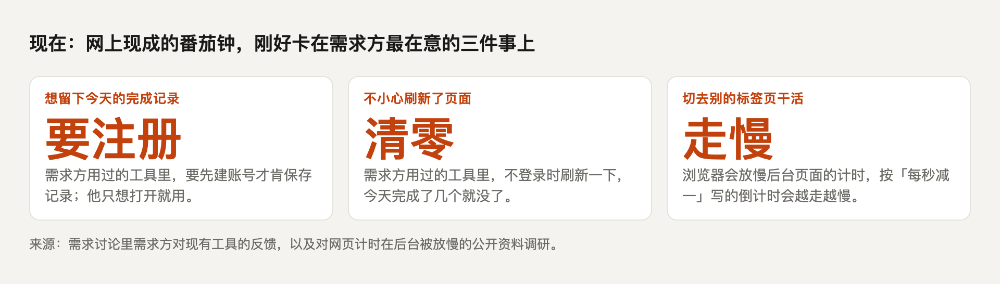
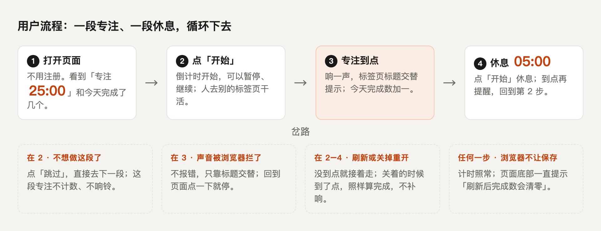
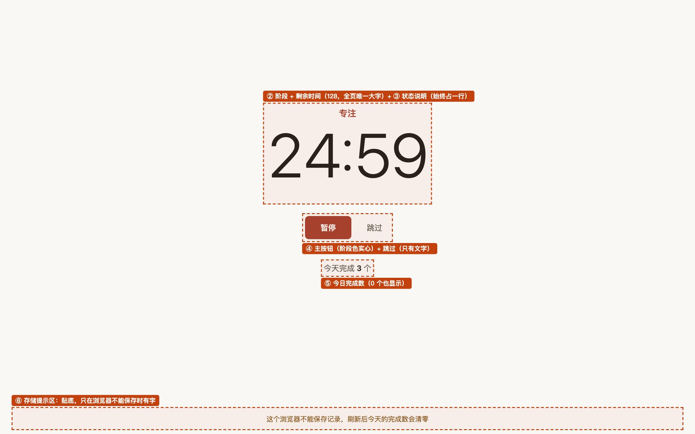
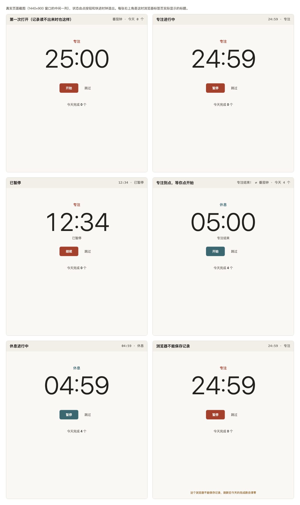
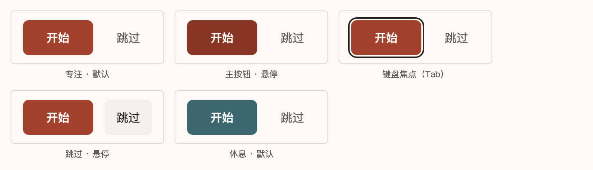

# 番茄钟

> 写给人看的需求设计文档：先看图，字只做注释。⚠️ = 待你拍板　⏳ = 已定未做完。末尾「关键改动」记最近的重要调整。

**一句话**：打开就能用的番茄钟网页——专注 25 分钟、休息 5 分钟，到点提醒，随时看到今天完成了几个。
**阶段**：已发布——验收通过，已合进主分支（还没有部署到网上；页面图都是真实页面截图）

## 待你拍板

1. ⚠️ **页面在后台时，到点铃声可能晚响**：浏览器会推迟后台页面的「到点检查」，纯网页做不到分秒不差。建议：先这样做，验收时在真实场景（页面放后台、前台用别的软件）量一下晚多少；明显影响使用，再加一个「你自己点开才会有」的桌面通知（见 3 用户流程）。
2. 两处我建议接受现状，你不回就按此：**手机锁屏期间不保证提醒**（解锁回到页面时立即补上计数和切段）；**同时开两个番茄钟页面时各走各的**，只保证完成数不丢、不互相覆盖（见 7 业务规则）。

---

## 1. 需求背景

- **谁**：需求方自己和几个同事。
- **场景**：上班时把番茄钟开在浏览器的一个标签页里，人在别的标签页和软件里干活，靠提醒回来看。

## 2. 目标与成功标准

| 标准 | 怎么算达到 | 现在 |
|---|---|---|
| **打开就能用** | 不注册、不登录，打开页面就能点「开始」 | 已实现；双击本地文件也能用 |
| **到点叫得到人** | 页面在后台、前台在用别的软件时，专注到点会响一声；标签页标题交替提示，直到回到页面 | 已实现；⏳ 后台晚响多少待验收时真实等待实测 |
| **完成数可信** | 刷新、关掉重开、浏览器自己重新加载，完成数都不丢、不漏记 | 已实现 |
| **手机上能看** | 手机竖屏一屏看全，没有横向滚动，按钮好点 | 已实现 |
| **安静** | 没有持续循环的动画，不弹任何权限框或确认框 | 已实现 |
| **零运行成本** | 纯静态网页，没有服务器、没有付费服务 | 已实现 |

**不做**：账号 · 云同步 · 团队协作 · 广告 · 统计图表和历史记录 · 任务列表 · 自定义时长 · 长休息 · 系统通知 · 静音开关 · 键盘快捷键

## 3. 用户流程

到点后自动切到下一段，但停在「待开始」，等你点「开始」——人不在座位时不会白白开始计时。

## 4. 页面布局

| 编号 | 区域 | 说明 |
|---|---|---|
| ① | 标签页标题 | 页面不在眼前时的主要信息出口，剩余时间放最前面（见 6 交互与细节） |
| ② | 阶段 + 剩余时间 | 剩余时间是整页唯一的大字；「专注」砖红、「休息」灰青 |
| ③ | 状态说明 | 只在暂停、到点后有字，其余时候空着但占一行，按钮不会跳 |
| ④ | 主按钮 + 跳过 | 主按钮是全页唯一的实心块，颜色跟着阶段换；跳过只有文字，任何时候都能点 |
| ⑤ | 今日完成数 | 今天是 0 也照常显示 |
| ⑥ | 存储提示 | 贴在页面底部，只在浏览器不让保存记录时有字；常驻、不能关、不弹窗 |

- 页面不滚动，内容居中一列、略微偏上；三块之间只靠留白分组，没有卡片、阴影、进度环。
- 手机竖屏结构不变，剩余时间缩小，两个按钮仍并排；手机横屏（窗口很矮）也换小字号，否则「专注」会被顶出屏幕。
- 想看真实尺寸、自己改值：打开[设计工作台](../assets/visuals/pomodoro/2026-10-23-skeleton-v1.0.html)（数值在 [DESIGN](../DESIGN.md) 第三节）。

## 5. 状态一览

| 情况 | 页面上的字 | 附带行为 |
|---|---|---|
| 专注到点 | 状态说明「专注结束」；标题「专注结束！」与「番茄钟 · 今天 N 个」交替 | 响一声；完成数加一；切到「休息 05:00」待开始 |
| 休息到点 | 状态说明「休息结束」；标题「休息结束！」与「番茄钟 · 今天 N 个」交替 | 响一声；切到「专注 25:00」待开始 |
| 声音被浏览器拦了 | 不出任何错误提示 | 只靠标题交替和状态说明 |
| 浏览器不让保存 | 「这个浏览器不能保存记录，刷新后今天的完成数会清零」 | 计时照常 |
| 记录读不出来 | 不出任何错误提示 | 当作第一次打开：专注 25:00、今天 0 个 |
| 到点后还没操作就刷新 | 状态说明为空，标题停在「番茄钟 · 今天 N 个」 | 刷新即算看到了提醒 |

## 6. 交互与细节

| 标签页标题 | 两个按钮 |
|---|---|
|  |  |
| 剩余时间放标题最前面，标签被挤窄也看得到；到点后两种文字交替（每秒换一次），直到你回到页面点一下或按个键。图是设计骨架的示意，标题文字和真实页面一致（见 5 状态一览各卡右上角）。 | 主按钮在「开始 / 暂停 / 继续」之间切换，鼠标放上去颜色深一档；跳过平时只有文字，放上去才有浅底；用键盘操作时两者都有黑色外框；休息时主按钮是灰青色。都不弹确认框。 |

- **到点交替何时停**：用户切回这个标签页，并在页面上点击或按任意键。
- **剩余时间怎么算**：按「这一段的结束时刻 − 现在」算，所以后台被放慢、电脑睡眠后回来，看到的都是真实剩余时间。
- **数字不跳**：所有数字等宽，走秒时不左右晃。
- **提示音**：一声约 0.8 秒的柔和单音（约 660Hz、音量很低），不循环；浏览器规定网页要先有人操作才能出声，所以要先点过一次主按钮，没点过就只靠标题交替。
- **页面上唯一会「动」的**：鼠标移上、移开按钮时，颜色有一下很短的过渡（约 0.1 秒）；到点或点跳过切换阶段时，主按钮颜色和阶段字一起直接换，没有过渡（鼠标正停在按钮上也一样）；没有闪烁、没有循环动画。系统开了「减少动态效果」时连悬停这一下也没有。

## 7. 业务规则

这是一个没有后端的页面，但下面这些口径决定了「完成数」对不对，单独列出。

| 规则 | 现在 |
|---|---|
| **时长** | 专注 25 分钟、休息 5 分钟，固定；没有长休息 |
| **什么算完成一个** | 专注段走到点才算；跳过的专注不算；休息不计数 |
| **「今天」怎么算** | 按本机日期，过零点从 0 开始；跨零点才结束的专注算新的一天 |
| **刷新或关掉重开** | 进行中且没到点 → 接着走；已暂停 → 保持暂停、剩余时间不变；待开始 → 保持 |
| **关着的时候到了点** | 专注段照样算完成一个，切到下一段待开始；不补响铃，标题不交替 |
| **那段在今天零点前就结束了** | 不计入今天，直接回到「专注 25:00」待开始 |
| **想放弃一段** | 只能点「跳过」 |
| **记录存在哪** | 只存在这台电脑的这个浏览器里；换浏览器、换设备看不到 |
| **同时开两个页面** | 各自计时，互不同步；完成数在已保存的最新值上加一，不互相覆盖；两个页面恢复的是同一段专注时，到点只算一个 |
| **记录读不出来或内容不对** | 当作没有记录，覆盖成正确的格式，不弹错误 |

---

## 细节在哪

| 想看 | 去哪 |
|---|---|
| 颜色、字号、间距的具体值（给 AI 看） | [DESIGN](../DESIGN.md) |
| 代码怎么分、本机记录格式、测试矩阵（给 AI 看） | [ENGINEERING](../ENGINEERING.md) |
| 在真实尺寸上看、改布局 | [设计工作台](../assets/visuals/pomodoro/2026-10-23-skeleton-v1.0.html) |
| 产品当前事实（给 AI 看的完整版） | [PRD](../PRD.md) |
| 每条规则的验收场景和检查表 | [Feature Spec](../../.features/pomodoro-timer/feature-spec.md) |
| 每个决定的理由 | [PRD 变更日志](../PRD-CHANGELOG.md) |
| 讨论原文、三个备选方案、对抗性审查 | [需求讨论](<../archive/raw/discussions/番茄钟/2026-10-23-番茄钟-需求讨论.md>) |

---

## 关键改动

> 最近 15 条，最新在上；更早的看 git。

| 日期 | 部分 | 改了什么 | 为什么 |
|---|---|---|---|
| 10-23 | 6 交互与细节、待拍板 | 切换阶段时主按钮换色有约 0.1 秒过渡（待拍板默认接受）→ 和阶段字一起直接换，悬停仍有过渡 | 用户反馈「到点时按钮颜色是慢慢变过去的，设计写的是直接切换」（BF-1023-1） |
| 10-23 | 4–6 页面图 | 设计骨架截图 → 真实页面截图（标签页标题条仍是骨架示意） | 页面已实现 |
| 10-23 | 7 业务规则 | 两个页面恢复同一段时没说怎么算 → 同一段只算一个 | 不处理会把一段专注算成两个 |
| 10-23 | 6 交互与细节 | 提示音音色没定 → 约 660Hz 柔和单音、约 0.8 秒，先点过主按钮才响 | 「短促、安静」；浏览器要求先有人操作才能出声 |
| 10-23 | 5 状态一览 | 到点后刷新怎么显示没说 → 刷新后按待开始显示、标题不交替 | 刷新即算看到了提醒，最简单 |
| 10-23 | 4 页面布局 | 页面示意 → 设计工作台骨架截图；手机横屏也换小字号 | 外观在工作台定稿；工作台实测横屏会把「专注」顶出屏幕 |
| 10-23 | 6 交互与细节 | 待开始时不能跳过 → 任何时候都能跳过 | 刚专注完想直接再来一段，不用先开始休息再跳过 |
| 10-23 | 7 业务规则 | 刷新后正在走的一段作废 → 接着走，关着时到点照样算完成 | 浏览器也会自己重新加载页面，作废会漏记完成数 |
| 10-23 | 6 交互与细节 | 标题格式没定 → 剩余时间放最前面，到点后交替提示 | 人主要在别的标签页干活，标题是主要信息出口 |
